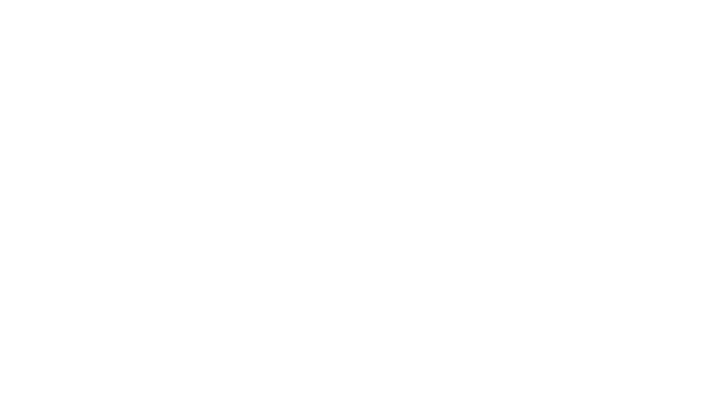
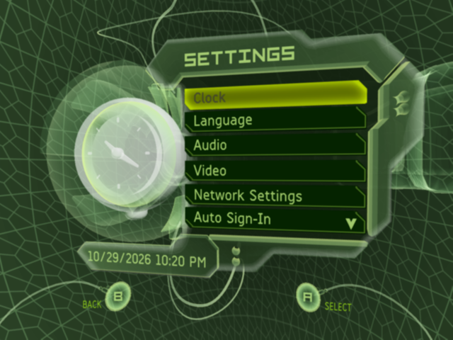

> **BETA:** XboxLLR is an early Xbox recompiler ecosystem. Expect bugs, incomplete hardware coverage and unsupported software. **Blinx is the only publicly supported game at this time.** Please [file reproducible GitHub issues](https://github.com/mstan/xboxllr/issues).

# XboxLLR

**Xbox Low Level Recompiler** is an early, low-level original Xbox recompilation
ecosystem: an ahead-of-time x86 recompiler pipeline, reusable console services,
native title host, Xbox-themed launcher and tools for preparing and building
individual titles. It was previously called **xboxlle**; some internal names
and checkout directories retain that spelling.

XboxLLR establishes console behavior through low-level devices and original-code
reference paths, then supplies native implementations under those contracts.
The fast Windows title profiles execute translated CPU code ahead of time.
Unresolved targets stop with diagnostics. This is ongoing compatibility work;
the downloads do not run arbitrary Xbox games.

## Downloads

| Download | Who it is for |
| --- | --- |
| **[Xbox Dashboard beta — Windows x64](https://github.com/mstan/xboxllr/releases/tag/dashboard-beta-2026.10.29.1)** | Run the original Dashboard 5960 using your own matching Dashboard executable and assets. Includes the launcher and native runtime. |
| **[XboxLLR build tool beta — Windows x64](https://github.com/mstan/xboxllr/releases/tag/toolkit-beta-2026.10.29.1)** | Developers: `xboxllr.exe`, bundled Python/Capstone, framework source and build drivers. MSVC, CMake and prepared title inputs are still required. [Build-tool guide](docs/BUILD-TOOL.md). |
| **[Blinx playable public alpha](https://github.com/mstan/BlinxRecomp/releases/tag/alpha-2026.10.29.1)** | Players: a ready-to-run native game package. No compiler required; supply your own supported NTSC-U game dump. |

Current playable downloads target **Windows x64 with D3D11**. Linux component
checks do not establish a working Linux game release. JSRF and other experimental
titles are not publicly supported in this beta.

## Blinx: The Time Sweeper

[BlinxRecomp](https://github.com/mstan/BlinxRecomp) is the first publicly supported
game. **Tested through World 2; end-to-end completion is not guaranteed.** Please
[report game bugs in BlinxRecomp](https://github.com/mstan/BlinxRecomp/issues).

The game package includes adaptive **Fit to screen** through 32:9, internal
resolution up to 2160p, FXAA, supersampling, anisotropic filtering, controller
selection, camera-invert options and optional blended 60/120 Hz presentation.
Blending preserves original simulation timing; it can add double edges and
latency. Actual higher-rate simulation is not currently available.

Optional gameplay mods remove the **ten-minute stage limit**, expand time-control
stock to 20, or provide infinite controls with non-heart crystals suppressed.
Those cheats are independent and off by default; heart crystals are preserved.
The disposable utility cache now stays in RAM, allocated on demand within a
750 MiB volume. Native in-game saves stay on persistent storage.
See [Blinx features and mods](https://github.com/mstan/BlinxRecomp#features).

## Original Xbox Dashboard

The native Dashboard preview supports Home, Memory, Music and Settings, local
console settings, persistent state and Credits/System Info screens. Xbox Live
stays offline. It is a separate title application, not a way to launch other
unprepared games inside this ecosystem.

### Load the Dashboard

1. Download the **Dashboard** Windows ZIP above and extract the entire package
   into a writable folder. Open **Start Game.exe**.
2. Supply your own original **Dashboard 5960** backup: `xboxdash.xbe` and its
   complete related asset tree from the Xbox C: partition. Preserve names and
   layout. A homebrew dashboard or the executable alone is insufficient.
3. Choose **Skip** in the optional console-files setup to create a new local
   console identity and save folders. No BIOS, EEPROM or large HDD image is
   required for direct native Dashboard launch.
4. On the main launcher screen, select that `xboxdash.xbe`. Select your
   controller in **Player 1**, then start. [Exact supported hash and setup details](docs/SETUP.md#dashboard-beta-quick-start).

The optional Xbox startup animation is on by default for Dashboard. It needs
startup data prepared from your compatible complete kernel dump. Without that
optional input, the title launches directly. This is a native reconstruction
of the animation, not a full firmware boot. Settings can import original console
files or select an existing supported raw/QCOW2 FATX image. Keep the package's
`data` folder, external save storage and any `<image>.xboxllr` profile when updating.

## Development and releases

Start with [developer setup](docs/DEVELOPMENT.md), the
[native-title driver](docs/NATIVE-TITLE-DRIVER.md) and [build-tool guide](docs/BUILD-TOOL.md).
Title repositories own revision metadata, mods and their tested framework pin;
shared CPU, graphics, audio, input, kernel and storage services belong here.
The older whole-console reference route has its own
[setup guide](docs/LEGACY-FULL-SYSTEM-SETUP.md).

Reusable release scripts create **separate Dashboard and build-tool archives**:
[`release_dashboard.py`](tools/release_dashboard.py),
[`release_toolkit.py`](tools/release_toolkit.py), and the shared
[`release_title.py`](tools/release_title.py) for Blinx.
See [public release instructions](docs/PUBLIC-RELEASES.md). Each playable ZIP
includes its corresponding project and prepared dependency source. Original
title bodies are regenerated privately from the user's matching input.

For failures, include the release version, Windows/GPU details, selected mods
and reproducible steps in a [GitHub issue](https://github.com/mstan/xboxllr/issues).
The launcher retains [crash diagnostics](docs/TESTER-DIAGNOSTICS.md). Review
attachments before sharing; never upload game files, keys, EEPROMs or saves
containing private console material.

## Credits and license

Development and integration: **Matthew Stanley**. Thanks to
[sp00nz / sp00nznet](https://github.com/sp00nznet/xboxrecomp),
[Phobos](https://github.com/phobos665/DirectXbox-Recomp),
[NoRain](https://github.com/NoRain211/doaxbv-re),
[xemu contributors](https://github.com/xemu-project/xemu) and
[apexJCL](https://github.com/apexJCL/blinx1-recomp).
The RAM-cache design was inspired by apexJCL's Blinx work; the implementation
here uses XboxLLR's own FATX storage. See [Credits](CREDITS.md) and
[exact component attribution](THIRD_PARTY_ATTRIBUTION.md).

Owner-original source uses [GPL version 3 or later](LICENSE), subject to
[license scope](LICENSE-SCOPE.md). Third-party work keeps its own terms.
Users supply original game and Dashboard data; no firmware, media, keys or
personal saves are bundled. [Original rights notice](RIGHTS-NOTICE.md).
The screenshots are real development captures; [image provenance and rights](docs/screenshots/NOTICE.md).
