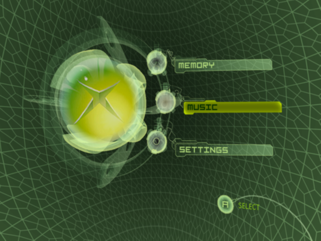
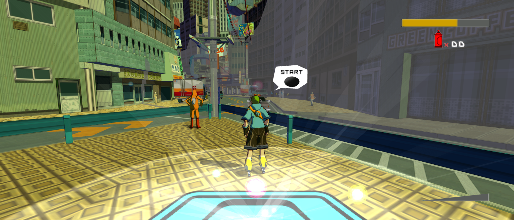

# xboxllr

**Xbox Low Level Recompiler** turns original Xbox CPU code into native host code
and supplies reusable console services. Its approach is to establish low-level
behavior, then use fast native implementations under the same observable
contracts. xboxllr was previously named **xboxlle**; some internal identifiers
and checkout directory names still use that name.

The current Windows x64 development previews run the original Xbox Dashboard,
Blinx: The Time Sweeper and Jet Set Radio Future. This is a shared framework;
game projects carry their own revision metadata, mods and tested framework pin.

| Xbox Dashboard | Blinx: The Time Sweeper | Jet Set Radio Future |
| --- | --- | --- |
|  |  |  |
| Interactive Home, Memory, Music and Settings; Xbox Live stays offline. | Assisted campaign through ending/save, five time controls and optional visual mods. | Native attract and gameplay, rapid campaign/encounter coverage and optional visual mods. |

*Actual development captures, not mockups. [Image credits](docs/screenshots/NOTICE.md).
Coverage is scoped in the linked title records below.*

[Architecture](#native-code-and-low-level-contracts) |
[Setup and required files](docs/SETUP.md) | [Development](#development) |
[Release plan](docs/RELEASE-READINESS.md) |
[Credits](CREDITS.md)

For crash reports, see [tester diagnostics](docs/TESTER-DIAGNOSTICS.md): retained
per-launch logs and optional private input reproduction sessions are shared by
the native title packages.

## Native code and low-level contracts

**Native** describes how CPU instructions execute. The title pipeline translates
original Xbox x86 functions into C and compiles them ahead of time. The fast
title profiles do not fall back to a guest x86 interpreter: unresolved targets
stop with a diagnostic.

**LLE and HLE** describe the level at which console behavior is implemented.
Maintained low-level devices and original-code reference routes establish
contracts for memory, files, input, graphics, audio and other services. Native
high-level implementations accelerate those services while preserving the
behavior visible to their callers. Accuracy work can refine those contracts
without forcing normal play through a slow whole-console reference run.

Reference and fast profiles are selected at build time. Normal gameplay does
not execute both paths in parallel. A retained LLE foundation also does not mean
every hardware detail or unreached game path is already qualified; evidence,
limits and deferred questions remain explicit.

xboxllr builds on work from the **xboxrecomp family** rather than replacing that
history. Its focus is shared console contracts, separately runnable correctness
references and reusable native services across titles. See
[Credits](CREDITS.md) for the people and projects behind those foundations.

## Current titles and enhancements

| Title | Current evidence | Record |
| --- | --- | --- |
| Original Xbox Dashboard 5960 | Responsive native menus, console settings, persistent state and themed Credits/System Info screens. Original Dashboard files are supplied by the owner. | [Dashboard burndown](docs/NATIVE-DASHBOARD-BURNDOWN.md) |
| Blinx: The Time Sweeper, NTSC-U | Bounded 9/9 attract qualification; assisted campaign through ending/save/title; widescreen owner playtest. Full natural mechanics coverage is separate. | [Game project](https://github.com/mstan/BlinxRecomp), [burndown](docs/BLINX-BURNDOWN.md) |
| Jet Set Radio Future, NTSC-U | Native attract and interactive gameplay; rapid campaign/boss-entry sweep with explicit cheats; save/load and brief owner visual review. Extra modes and exhaustive mechanics remain deferred. | [Game project](https://github.com/mstan/JSRFRecomp), [shared title driver](docs/NATIVE-TITLE-DRIVER.md) |

The shared launcher provides Player 1 controller selection and optional visual
mods. Current game profiles support adaptive widescreen through 32:9, internal
heights through 2160p, FXAA, supersampling, filtering and blended 60/120 Hz
presentation. Actual faster game simulation is a separate mode and is unavailable
until its title timing adapter is qualified. Details and costs are recorded in
the [visual-mod design](docs/NATIVE-VISUAL-MODS-2026-10-18.md).

## Development

Start with the [developer setup guide](docs/DEVELOPMENT.md) for a clean checkout,
toolchains, ROM-free checks, pinned dependencies and native title builds.
Use the [native-title driver guide](docs/NATIVE-TITLE-DRIVER.md) and
[native reference pilot documentation](pilots/native-title/README.md) for current
build profiles, private input preparation and bounded validation. Title projects
pin this framework; shared CPU, kernel, renderer, audio and input changes belong
here, with title identity, revision bindings and data-only mods in each game repo.

The current native host uses Windows APIs, D3D11 and XAudio2. Generated C and
portable component tests alone do not establish a native Linux game build.
Linux host/backend work and real title validation are required before a Linux
release is advertised.

The older whole-console route has different requirements and performance. Its
former README is preserved as the
[legacy full-system setup guide](docs/LEGACY-FULL-SYSTEM-SETUP.md), rather than
used as instructions for the native previews.

## Toward a release

xboxllr is intended to publish the **recompiler toolkit** and a separate
**Dashboard title** artifact. Blinx and JSRF retain their own game repos and
reuse build/release tooling from a pinned xboxllr version. Windows x64 ZIPs are
the current target; native Linux releases are deferred. Shared packaging now
produces self-contained local candidates with a bundled launcher and Python.
The current [release](https://github.com/mstan/xboxllr/releases/tag/windows-preview-2026-10-23.2)
provides the recompiler/framework source toolkit and a precompiled Windows
Dashboard application, with source and dependency-source downloads. The toolkit
includes the shared Windows controller event-pump fix; the Dashboard and both
game previews use the same correction. See the
[controller hotfix notes](docs/RELEASE-NOTES-2026-10-23.2.md). The toolkit
is Python/source tooling rather than a standalone compiler EXE. Users supply
their own supported original title data; see [license scope](LICENSE-SCOPE.md)
and [original rights notice](RIGHTS-NOTICE.md).

The setup target is the user's matching game dump, plus original Dashboard files
only if they want that Dashboard. Writable console storage, settings and other
supported generated inputs are created locally. On first launch, choose **Skip**
to use a persistent virtual-console identity and automatic private save folders.
Original console files are optional for new local play. Settings also accepts
an existing raw/QCOW2 FATX HDD image with validated original signing inputs and
matching EEPROM. An image takes priority over folder storage; no 8 GB image is
created per game. See [setup](docs/SETUP.md) for save compatibility and limits.
Select the supported extracted XBE on the main screen and keep its complete
asset folder. Direct ISO import remains unfinished.

Neither native games nor the native Dashboard currently boot the firmware.
Firmware startup is a separate follow-up: if qualified, its intended default
is off for games and on for Dashboard. A redistributable default dashboard
also remains a future capability; the current Dashboard needs your own files.

The [release readiness plan](docs/RELEASE-READINESS.md) tracks shared packaging,
clean-machine setup, native Linux support and incorporated-code licensing.
The owner selected GPL distribution on October 22. Windows title downloads
are accompanied by project and prepared dependency source. Original Xbox
firmware, XBEs, game media, Dashboard data/assets, keys and saves are supplied
separately by users; original-title source bodies are generated from their input.

## Credits and license

Development and integration: **Matthew Stanley**. Special thanks to
[sp00nz / sp00nznet](https://github.com/sp00nznet/xboxrecomp),
[Phobos](https://github.com/phobos665/DirectXbox-Recomp),
[NoRain](https://github.com/NoRain211/doaxbv-re), and the
[xemu team](https://github.com/xemu-project/xemu).

Readable recognition is in [Credits](CREDITS.md). Exact revisions, imported files,
modifications and license notices are in
[third-party attribution](THIRD_PARTY_ATTRIBUTION.md).
Owner-original material uses [GNU GPL version 3 or later](LICENSE), subject to
[license scope](LICENSE-SCOPE.md). Third-party work retains its own terms.
Neither this grant nor private repository visibility changes original-media
rights. Original-title source bodies and original media are not in the source
downloads; native applications contain ahead-of-time translated execution code.
See [the original rights notice](RIGHTS-NOTICE.md).
