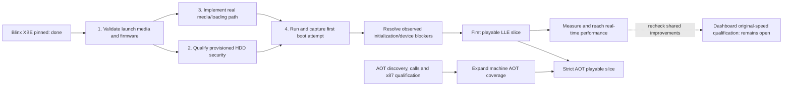

# Blinx: serial attract-sequence bring-up

## LLE contract hardening burndown - 2026-10-08

The owner-approved [bounded closing checklist](BLINX-QUALIFICATION-CLOSURE.md)
now governs remaining work and family acceptance. Exhaustive scene numerical
proof stays deferred; working LLE routing/processing and connected title evidence
remain required. Existing blocked-fence/full64-slot evidence is reused.

**Current status, 2026-10-16: 6/9 bounded families qualified.** Movies and
scheduling now close alongside input, display, memory and files. The full Q03
capture completed 600 GP seconds with all seven numeric gates passing. Two
natural openings, actual later movie interruption, title return and fresh demo
gameplay are accepted after root scene/ownership review. Final audio census A01
also closes; the audio family now requires normal connected Stop/reuse and
continued output through that transition.

| Qualified | Remaining required | Recorded questions / current deferral scope |
| --- | --- | --- |
| Input, display, memory, files, scheduling, movies | Audio A05 normal Stop/reuse and continued output; representative connected output passes, A03 drained reset/reentry and isolated A04 components complete; GPU/graphics G02-G05 | 43 retained IDs; 42 contain deferred scope, including unconsumed inherited fog state, inactive patch processing, AV service-edge precision, nominal interpolation precision, additional boot profiles and exhaustive reset/failure combinations. GFX-D06 is required; GFX-D04 splits required behavior from precision. |

Latest checkpoint: the stopped, locked PCM16 restart cursor fix38f6836 passes
its original-code reproduction and independent source-output comparison. The
changed muted title acceptance run now completes its actual same-buffer
Stop/restart plus96000 continued frames on both output routes after4022.640s,
with no guard. Finalized lifecycle provenance passes, but the continued-output
waveform comparison lacks an established isolated-source premise: concurrent
streams overlap every scored window, and the initial stage trace filled before
restart. A separate bounded Stop-triggered stage window is committed5439711;
its actual-journal trigger replay passes. Root reviewed381 input identities and
the single changed muted capture started2026-10-16 at07:52:46UTC, with the same
four-core/Normal limit and actual lifecycle/output early stop. Audio
remains open. GPU commits
7765ecf/60bb8d7/897ab10 add the owned CPU UMA aperture, inactive FD clears,
compiled callback bus ownership and explicit context-selector behavior. Actual
original execution produced its complete context image and requested its first
load. Eight complete draw submissions are captured but have not executed.
Consumed saved-state mapping and real load/save remain the main GPU blocker;
graphics output follows. GFX-D21 defers only an inherited fog value with no
consumer in this prefix. Read-only hardware checks identified disabled engines;
a guarded PGRAPH-only enable now succeeds and25 fixed follow-up reads complete.
FIFO remains disabled. A subsequent read-only reservation query and20KiB
comparison reject both tested CPU/PRAMIN layouts; no backing map or context
transfer is inferred. Retained state is not reset-default proof. See the
[current closing checklist](BLINX-QUALIFICATION-CLOSURE.md).

Earlier capture checkpoint: the retained-buffer title ended cleanly at its
one-hour host ceiling:8647 calls, five Plays, no Stop and no guards. The actual
1440-update title transition had not occurred. Its framing/cadence and identical
accepted initial trace are preserved. The host ceiling correction passes four
observer cases; one fresh muted capture now runs with a two-hour maximum and
the same automatic lifecycle stop, four-core/Normal limit and game detector.
Guest timing/audio remain unchanged. A source-bound round1
post-restart oracle is ready, but has no transition to score yet. In parallel,
the differential FP DEBUG/one-pixel HSYNC probe passes nine offline tests and
remains unexecuted. Its omitted CRTC/encoder steps are explicit limitations,
not grounds to close G02. See the
[current checkpoint](BLINX-QUALIFICATION-CLOSURE.md#lifecycle-capture-limit-and-next-graphics-experiment---2026-10-15).

Prior graphics checkpoint: the maintained quiescent AV protocol now services
pending requests from actual GPU clock work; reads cannot complete them and
acknowledgment cannot activate an FP bank. Both original direct and guest-thread
AV calls pass their initial handshake in both idle phases and preserve caller
canaries at the next FP_DEBUG guard. Eight focused checks pass. Source review
identifies original AV3 as the producer of retained8A encoder initialization,
removing the need to guess its initial readback bytes. FP_DEBUG, active timing,
the actual initializer return and connected rendering remain required. The one
existing muted audio lifecycle run continues while the authorized Sol6.1 worker
reviews its evidence. This is component progress; families remain6/9. See the
[current milestone](BLINX-QUALIFICATION-CLOSURE.md#quiescent-av-protocol-and-original-initializer---2026-10-15).

Earlier checkpoint: the GP/EP chronology fix `4f92b9b` passes 54 affected checks
and the changed title's 4,334 comparable input groups are all consecutive.
Analog/digital payloads match; 393 EP blocks and derived states match the
independent processor model. The 768.875s muted title check is complete, with
no guards. An independent worker's direct reconstruction of the declared nominal
resampler matches all 101,184 captured stereo rate frames bit-for-bit. Root
verified the reconstruction and input pins. Independent ADX through that kernel
and the EP model passes all three output windows under unchanged limits: worst
RMSE 0.0001381, minimum correlation 0.9999657. The initial mismatch came from
using a different comparison filter. Exact silicon interpolation is recorded as
AUDIO-D15; no full-band threshold was loosened. Next observe actual normal
Stop/reuse and continued output. The first Start only
opens a menu, and final Release is not required for this retained-buffer path.
`c3e0127` publishes a completed stage prefix while a future title run continues,
allowing early diagnosis without repeated startup. One Sol6.1 worker completed
independent waveform, lifecycle and G02 reviews; remaining graphics activation
questions retain their final-phase hardware boundary. See the current closing
checklist for evidence and limits. No family closes in this checkpoint.

Earlier feedback milestone: the real hotplug/Start capture finishes without a
guard;3479 analog/digital blocks contain3,562,496 identical payload bytes per
stream. The1806s host run represents18.555s of audio. It does not close connected
lifecycle/timing. The owner requested shorter feedback loops: affected fixture
checks take seconds, and live API observations plus cooperative early capture
finalization replace blind fixed-duration title runs. An early125s check caught
and retained an incorrect compiled-wrapper observer; recording now targets the
actual original CPU. See the current closing checklist for scope and evidence.
The corrected capture exposed an idle-callback stack guard after402.797s.
A short fixture reproduces the same ordinal149 failure: the actual IRQ uses
the nested original service's guarded stack while idle metadata remains valid.
The fix validates the active service depth/caller/bounds and preserves idle
metadata rejection. Seven affected checks pass in2.00s; the new regression takes
0.57s. One changed title check then crosses hotplug/Start/release and stops on
its planned11.5-guest-second observation after646.203 host seconds, without a
guard. Its607 completed original calls, movie observations and matching
1,169,408-byte audio streams are retained. `.113.36` closes. Actual Stop/restart,
final release and movie-relative timing still require A05 review; input delivery
alone does not prove those transitions. Reuse this saved prefix before deciding
whether a further capture is needed. That title is terminal; families remain6/9.

Saved-prefix review now identifies silent `h_title02a` background footage with
16ms p95 relative PTS error and four PCM-ring wraps with the original128-byte
write-cursor lead. It cannot establish opening-movie A/V. The next changed
capture adds passive, source-bound original XInputGetState results, keeps the
controller neutral after hotplug, and collects all observations together. An
automatic lifecycle/output checkpoint can request cooperative early finalization;
its six host-observer checks pass in0.60s. The title builds using retained AOT
objects and is pending acceptance at `audio-neutral-lifecycle-20261015`.
A saved-output/decoded-ADX comparison remains diagnostic until the complete DSP
configuration is bound; it neither closes A05 nor establishes a new device bug.
See the first section of the closing checklist. No hardware work or new deferral.

Prior audio milestone: `.115` closes for supported serialized FE work. The
original kernel now executes its queued DPC, actual device token publication
and completion consumer; four original cases pass, including retained ownership
after the original timeout. All55 affected native/device checks pass. A04's
isolated ordering/retirement components are complete. A05's actual connected
output/timing and normal stop/reuse/reentry remain. The first controller-connected
title check exposes an early USB/audio counter-calibration read before XGSCNT
initialization. A separate muted check reuses the same binary and established
disconnected startup with actual later hotplug; initial-connected startup remains
an explicit scope question, with no new acceptance or deferral claimed. This reuses prior physical token and
HLE output/ownership evidence; arbitrary queued work and exact latency remain
guarded or deferred. See the latest section of the closing checklist. The
following dated checkpoints retain their earlier remaining-work descriptions.

The configured-reset model now admits original drained GP/EP retirement and
reentry on the same CPU/RAM owners. Three original driver configurations each
complete two processed generations and original allocation cleanup. Active FE
notification and complete connected output remain required; this component
closure does not change the6/9 family count. See the current closing checklist
for the evidence and remaining gates.

The active FE hardware comparison now establishes original2010C=0 stopping
SE15->7. Releasing FE control allows the following20104 submission to reclaim
PIO space, but the real notifier remains pending beyond10ms. The maintained
model now executes the original668us timeout with actual work. All3
configurations pass two generations of retirement/reentry and original cleanup.
Selector2 stops its remaining computation through the original reset, after
transfers drain; no ready flag or completion is fabricated. DPC FEMEM completion
and connected output remain. Earlier notification completion no longer blocks
the isolated shutdown component; connected output acceptance still determines
the full-profile deferral. No HLE runtime or accepted visuals changed.

Analog cyclic traversal is now independently observed on the Xbox for one- and
two-node rings. The LLE no longer halts after the initial8KiB;51 affected checks
and three original codec stream/interrupt lifetimes pass, including repeating
nonzero data, acknowledgement, stop/restart and original allocation cleanup.
The changed muted title now captures1,389,568 analog bytes, exactly matching
digital PCM;387 blocks also match actual EP FIFO0 writes with zero differences.
This closes cyclic-output issue `.113.34`. DPC memory fence ordering and complete
output/timing/retirement still prevent audio closure; the capture is partial.

The [deferral reconciliation](../pilots/native-title/GRAPHICS-DEFERRED-QUESTIONS.md#current-disposition---2026-10-14)
preserves every question/evidence/reopening trigger and identifies promoted work.
Earlier dated totals do not override these current dispositions.

Required GP bit9 input/output now passes independent physical observations,
and the unchanged preserved original graph passes all1,501 blocks and73,549
DMA nodes. The original GP configuration also reaches its first C4 yield
through the maintained sole CPU owner, with the hardware observer's seven
counter samples reproduced. All three original EP configurations now sustain32
events with representative PCM/AC-3 numerical checks. Initialized-kernel
SECTL/IEN are source-derived; startup FE control is independently admitted
without granting notification completion. Bounded reset controls now route to
the sole DSP CPUs and fetch their actual SG bootstrap images; six original
images and retained physical loaded-P observations support that connection.
Physical XGSCNT observations now support stopped retention, zero initialization,
mode1 progression and resume; the unconditional uptime counter is corrected.
The stopped initialization batch now admits23 physically observed configuration
fields and the original FE control sequence. Captured pre-video FECTL state is
part of the explicit kernel handoff. Three live original initializer transports
and all36 targeted checks pass at that checkpoint. The subsequent VP mapping
batch passes37 checks and18 original mapping writes across three lifetimes.
The next physical batch resolved that method experiment: original startup clears
FE1510, while the inherited control1 held the command pair. Differential field
mapping, input publication to VPSGE and output publication to GPF now support
three complete original VP initializer returns. All38 targeted checks pass.
The subsequent AC97 batch identifies the actual WM9709 DAC, corrects generic
mixer/rate defaults and connects asynchronous CAS completion to the shared
guest clock. Both stopped output rings pass original reset/setup;42 targeted
checks and three original codec helper groups pass. The latest changed105.5s
muted title run crosses the enclosing original codec initialization/IRQ setup
and reaches GP DWORD WRITE FE83FF00=0, with zero captured PCM. Remote SMC
restart and probe launch recovered the earlier immediate-CAS experiment without
manual input; the bounded follow-up passes. No manual recovery remains pending.
The subsequent CPU host controls and physically observed1000/1004 output
methods now let the unchanged original GP/EP setup return in three lifetimes.
Each uses102 maintained device transactions and eleven live owned RAM accesses,
with one exact bootstrap per DSP. Ten focused checks pass, including current
GP/EP and actual FIFO transfer regressions. All three stopped hardware
experiments recovered remotely; the console is listening with no manual action
pending. The extra length2100 trap remains guarded and recorded as AUDIO-D11.
The enclosing GP/EP setup now also returns through its original10ms wait in
three lifetimes: the shared clock runs GP to its real yield and EP through its
real polling instructions, with zero frame events. Thirty focused checks pass.
The connected title checkpoint still predates these changes.
Remaining audio work is active VP methods/tables, shared frame cadence, active
reset/FE ordering and actual title output. See the
[current closing checklist](BLINX-QUALIFICATION-CLOSURE.md#original-ac97-startup-crossed---2026-10-14).

One full changed capture supplied movie, scheduling and census evidence; no
unchanged title/component reruns were added. Host load did not pause it. Durable
evidence is on F: under `build/blinx/q03-final-20261013`; root proof SHA256
`aee59a1cab5ee2e8e26d6d818f5ddad010b87150cf2e98c0b4bdfc0d2d301ea7`.
See [closing evidence](BLINX-QUALIFICATION-CLOSURE.md#movies-scheduling-and-final-census-closed---2026-10-13).
Hardware resumed on 2026-10-13: fresh owned GP mapping/calibration and the actual
marker/bootstrap pass. A separate fresh source now also passes physical preparation,
installation and loaded-program verification. Its unique execution witnesses
appear, but status/descriptor/target results disagree with the offline model.
An offline reproduction exposed and fixed fallthrough after a diagnostic STOP;
DMA acceptance still requires a fresh hardware run. Read-only kernel
evidence also distinguishes live encoder selection D4 from retained 8A. See the
[physical result and next task](BLINX-QUALIFICATION-CLOSURE.md#fresh-gp-execution-exposes-a-diagnostic-mismatch---2026-10-13).
Read/benign-write authorization remains in force. Earlier dated progress notes
below retain their historical family counts.

**Earlier reference-movie continuation, 2026-10-11:** the maintained caller-driven
APU/DSP selection now shares controlled PIT time with original scheduling,
display, USB SOF and XGSCNT. Twenty focused profile checks, strengthened SOF
coverage, fast/delayed original idle/compute output comparisons and six bounded
capture/negative checks pass. The first immutable original title batch was stopped
after its trace established source rereads before new caller writes: the explicit
8,000-block input schedule advances simulated device time too far for the game
work it admits. Host execution speed is not the acceptance criterion. Correct
relative execution/device timing and full original movie completion/reuse/
interruption remain open. Existing default-HLE full movie
proof is reused. Independent audio loop-span provenance `.113.20` is closed at
`aba91ea` after16 checks and71,506 actual submitted frames with zero mismatches.
Audio effects failure guard `.113.19` is closed at `ed7b716`: three genuine
original allocation failures, two causal native failure guards, unchanged
successful replacement logs and four maintained audio checks pass. Continued-call
failure parity remains explicitly unsupported under that issue's guard scope.
The whole-family count remains **4/9**, with **26 precision deferrals**. See the
[reference runtime and capture scope](BLINX-MOVIE-STALL-AUDIT-2026-10-08.md#maintained-reference-consumer-and-bounded-capture---2026-10-11).

**Bounded-plan progress, 2026-10-12:** common reference timestamps Q01 and short
relative-time checkpoint Q02 pass. Original queued Reset/Release G01 passes15
selected original checks and13 native regressions. Tasks `.116.4` and `.116.5`
are closed; full original movie lifecycles, graphics startup/output and original
audio device integration remain required. A02's ordinary constructor/bypass/
phase0 processing now passes12 actual original PCM/ADPCM lives, with8 persistent
guards and12 wrong-gain controls; `.113.22` is closed at `12daa02`. The required
original-scheduler host-to-OHCI connection is fixed at `99b06b4`: five affected
checks pass, and its unbound control fails on the actual Start report bytes.
Frozen Q03 generation v6 ran muted/invisible on two logical CPUs, with
actual replay initialization confirmed. Its final-analysis waiter starts no
title and cannot automatically close a family. The first
opening now reaches2263, real75.567s Stop/Destroy and title. Full independent
waveform and A/V checks pass after correcting the analyzer's ideal44100 rate
to independently established original packed pitch-501; the failed nominal
comparison is retained. At first-demo startup, model133.43s, the title then
self-returned2 after3773.188 wall seconds on the real guest-call-frame handoff
guard (ordinal166, entries0). Its78 finalized artifacts and zero-error capture
are verified. A one-second CPU fixture reproduced the same guard, and
`30a6be6` fixes selected workers' contiguous-service transport while preserving
the root-only guard. Seven focused checks pass across three real original CPU
lifetimes. Changed generation v7 crosses that actual allocation, then stops
after3790.953 wall seconds at missing original calendar305 admission. Root
verifies340 immutable source/artifact identities and zero-error finalization;
the two corrected-boundary and passive-observer audits are closed, while Q03
stays open. Three short real original CPU calendar304/305 lives and four
continuation regressions pass after admitting their unchanged RET8 bodies.
The static remaining-import audit is complete. Original heap comparison269
and caller-owned Unicode308 are admitted as one coherent RET12 batch; allocating
Unicode remains guarded before mutation until pool ownership is connected.
Nine focused checks pass in1.22s, including36 actual helper CALL/RET cases,
two allocation guards, calendar and four continuation regressions. Event,
crypto/key, IRP, FP/exception and firmware branches retain named ownership or
error guards; static call coverage does not claim dynamic unreachability.
Changed Q03 generation v8 is now running from `910b4f1`, with the same
replay/cadence/capture/six-hour bounds and a verified fresh8GiB disk. Private
IO/title-only builds reuse12 pinned dependencies; no library/test repetition.
Initial replay/common-clock/GP capture routes are observed. Four logical CPUs
at Normal priority are available with the worker idle; Marvel Rivals detection
reduces allocation to two/BelowNormal. Frozen independent numeric/scene review
is queued once after successful finalization. Full acceptance remains pending.
That run has now passed the former calendar305 stop into rendered first-demo
gameplay and ADPCM voice creation. Root accepts the bounded integration at proof
`31c80d58b62eac7909c654b2d4e64f537d211eb08bc3838160303b537773a3bf`;
calendar task `.112.2.18` is closed, reusing its actual CPU controls without a
rerun. Movie/scheduling family acceptance still awaits the full lifetimes.
Sol6.1's partial audio census and root adversarial review now cover194 actual
ADPCM Plays with custom sends and nonzero loops; existing independent stage
evidence applies, with full original device/output and final census still open.
Root proof `3cfbd0dd7691e14e6c9319e15f984088fe39586c7467585e17352c74e200acf0`
records the acceptance limits. The owner has turned the Xbox off and requested
all hardware operations deferred until the final batch after offline work.
The rejected-batch analyzer/gallery waiters run no numeric/title repetition.
Analyzer `2075d64` retains any later diagnostic opening without
substituting it for the required two natural and one interrupted lifetimes;
12 analyzer controls pass with target acceptance gates unchanged. Movies and
scheduling remain open pending the full required title lifetimes. Fixed encoder-read
preparation `.111.1` is also root-reviewed and closed, with11 focused controls
and182 suite passes/3 existing optional skips; actual startup is unresolved.
G03 now has
an explicit PGRAPH image load/save mapping dependency, separately from hardware
RAMFC questions. Retained startup logs do not contain the required same-object
image/queue; their earlier CX25871 `EN_REG_RD` guard must be resolved before
another first-load capture. The passive collector is implemented at `24468bc`,
with34 compiled ABI controls, two raw observer cases, three disabled-observer
CPU regressions and root104-pin review. Its real+784 guard remains unchanged;
actual PGRAPH image transfer is still required. The final hardware sequence is grouped by these
required dependencies in the closing checklist. This is subgate progress, with
the whole-family count still4/9.
See the fixed [closing checklist](BLINX-QUALIFICATION-CLOSURE.md).

Tracked in `beads-xbox.1.102`; baseline is the committed working attract
milestone below. Follow [recomp-template HLE.md](../../../recomp-template/HLE.md)
verbatim: LLE is the maintained correctness foundation; HLE is its performance
replacement under the caller-visible contract. A working HLE implementation
does not remove the requirement to implement and maintain its LLE counterpart.
Original-code fixtures, xemu comparisons and plausible output provide evidence;
they do not substitute for our working LLE route.

There are **nine scoped service-family acceptance gates** in this phase. Every
family already has some implementation/test coverage, but that does not establish
a complete LLE route for each native replacement. Each closes only after its
LLE route, independent qualification and matching HLE contract are recorded.
This is not an estimate of missing implementation, a percentage of Xbox emulation,
or a calendar forecast.
The actual family count starts at **9 open / 0 closed** on 2026-10-08;
the bounded input, display, memory, filesystem, scheduling and movie gates now
bring it to **3 open / 6 closed**.
The owner requested **serial delivery from least complex to most complex**.
The latest owner instruction defers all Xbox operations until the final hardware
batch after offline qualification. Offline work has now closed movies/scheduling
and the final voice census. Audio (`.113`), GPU (`.109`) and graphics (`.116`)
retain their qualified slices; their remaining required startup/state/output
semantics are listed in the closing checklist. Existing read/benign-write
authorization persists, with fresh recovery/readiness and owned mapping required
before operations following the earlier unexpected write.
Calendar conversion is the first small slice of the scheduling/time family;
finishing it does not close that larger family. These ten delivery entries and
nine acceptance gates deliberately use different granularity.

Owner follow-up: bundle related LLE cases that share setup/reference state,
including coherent dependency chains within the active family. Run focused
checks during implementation, one combined qualification pass, and one actual
Blinx regression per coherent batch. Retain explicit outcomes for each contract;
a bundled pass does not close an unimplemented service. Reuse captured evidence
and avoid repeating whole attract runs for documentation or test-only changes.

Earlier scheduling integration milestones (now closed by Q03): busy GPU waits,
full64-slot pressure, Swap/vblank and real KTIMER/KDPC callback lifetimes pass.
The original CPU now shares the maintained OHCI owner and advances USB DMA
during a real blocked delay without device polling. A generated-callback EBP
publication bug is corrected at the original dispatcher boundary. Actual
124/143/144 priority query/set and boost controls now pass three CPU lifetimes
with genuine ready/block/wake ordering and exact cleanup. A causal terminated
stack publication defect and the inner graphics callback EBP boundary are fixed.
Actual IRQ/KDPC page query/pin/unpin and physical bytes now pass three exact
reusable lifetimes after an explicitly checked startup settlement. Actual title
diagnostics confirm all three USB pin/query/unpin chains return and publish.
The subsequent priority inversion was a shared renderer/audio gate held across
the pure vertical-blank wait. Its scope is corrected; a real CPU peer executes
original277/294 during that wait over three exact lifetimes. Whole audio effects
setup now retains a copied graph/descriptor, with twelve installs/replacements
and actual original199 source release across three exact CPU lifetimes.
Actual original327/328 section lifetimes now pass file bytes, zero-fill,
reload, shared-boundary retention and queried readonly policy, with a pinned
unload rejection before mutation. The current filename failure is resolved:
the captured boot worker completes original optical-device initialization, then
a genuine event/suspend handoff parks it before its obsolete image launch.
Default HLE preload/cold-load readonly protection and shared-page recommit
policy match the original section helper. The late USB stall is now causal:
the expanded interpreter alias cache exceeded Unicorn's12-bit physical-section
index, silently dropping actual MMIO reads/writes. The identical linked engine
reproduces the failure at4202 regions and preserves routing at3902. Resident
aliases now retire at a pre-instruction block boundary, preserving original
PTE/PFN/publication/DMA ownership and the full CPU context. Three real CPU1536-page
lifetimes check every page, checksum, actual OHCI MOV/readback and exact cleanup.
The current combined batch passes **84/84**, with rebuilt GPU bus, live compute/
idle interrupt stack and default native checks also passing. The earlier v60
host-handle failure remains retained; current assertions are unchanged.
Actual muted v69 reaches31 presents and sustained movie/input progress, with
the late ControlHead store delivered, EP0 requests5->8 and25,468 USB TDs retired.
It reaches its342.984s observation limit with no STOP/guard/fault. Chronological
presents9-31 match forward Microsoft intro frames1-138: about4.6s of content
across180s wall time, with no later publisher/opening transition established.
This resolves the old main cancel wait; the next bounded investigation separates
original CPU execution cost from wait/cursor ownership before another long run.
Exact publication reuse now passes three raw page-table mutation guards and
the combined88-check batch. The later v73 capture advances through Microsoft,
Artoon and opening frames0-187, then faults at325.422s inside Unicorn's host
translation allocator. Small unchanged-library cases reproduce its Windows
commit request extending past the reserved buffer; a bounded correction is
now qualified in four engine checks. Rebuilt profiles with that package pass
88 combined and three NV2A bus checks. The raw decoder remains original, with a passive-level
admission shortcut preserving actual IRQ/FP/thread ownership. This is the
current integration repair; the faulted observation does not pass
the original movie gate.
The rebuilt v75 observation now reaches901.984s without STOP/guard/fault,
with forward opening content through frame2119/PTS70.704667. Three finite
audio windows complete with zero overflow and exact caller-ring ownership.
The original producer supplies about28s of fresh audio during250s of real
sink consumption, which repeatedly laps the ring. This is the remaining
reference-time composition problem `.123`, rather than a need to make LLE
real-time or replay the same run longer. Final original completion and
synchronized lifecycle coverage remain open. See the
[current source-bound diagnosis](BLINX-MOVIE-STALL-AUDIT-2026-10-08.md#composed-original-movie-observation-and-consumer-replay---2026-10-11).
Integrated attract remains open. HLE incurs no interpreter cache work.
The separate controlled input/observer clock seam now passes90/90 combined
checks. Fast and delayed original waits produce the same35ms guest progression;
the caller-driven maintained APU/DSP consumer now also passes the composed
original-kernel test:1,680 actual output frames, source reads and DSP state
remain identical through host delays. The complete original position API
passes168 cases against actual source CBO. Ordinary movie controls and runtime
clock/capture integration are next, before full original movie completion.
No title run was repeated for
this foundation. See the
[current reference-time work](BLINX-MOVIE-STALL-AUDIT-2026-10-08.md#original-positions-and-composed-clockaudio---2026-10-11).
Earlier filename/open/cache failures retain their separate generations.
Independent GPU/graphics/audio/movie gates stay open. **4/9 families** and
**26 precision deferrals** are unchanged.
See the [current boundary](../pilots/native-title/SCHEDULING-LLE.md#exact-publication-reuse-and-current-original-movie-integration---2026-10-11).

The current default native HLE scheduler is now enabled when its diagnostic
environment selection is unset; the original-kernel route keeps sole CPU
ownership. Earlier working movie runs explicitly selected the scheduler, while
the unset route still stalled after Microsoft. Fresh muted v62 advances through
Microsoft, Artoon, the complete opening, title movie and gameplay. All recorded
audio submissions equal the prior caller buffers with zero capture overflow;
current GP output tracks75.6s of opening PCM, and the distinctive final picture,
real voice retirement and next-title loading establish one normal opening.
This closes the default-path stall. A subsequent current default HLE batch
now passes two natural opening lifetimes, real Start interruption, title/menu
return and fresh demo reentry, with exact selected-movie ring-byte provenance
and fresh full GP-output comparisons. The specific ring-cycle/stalled-opening
bug `.98` is closed in commit3812a2b. **Movies remain open** for completed
composed-original-LLE coverage. Exact
physical A/V timing remains separately scoped. Reuse this current source-bound
capture rather than repeating playback for documentation or another still review.
See the [current opening acceptance](BLINX-MOVIE-STALL-AUDIT-2026-10-08.md#current-default-hle-opening-acceptance---2026-10-11).
The [repeat/interruption acceptance](BLINX-MOVIE-STALL-AUDIT-2026-10-08.md#current-default-hle-repeat-and-interruption---2026-10-11)
records the completed subgates and remaining original-route requirement.

The typed original-CPU/native graphics bridge now binds129 original entry
bodies and retains their real return ABI and engine-owned caller state. The
composed VM route executes39 original kernel services across three CPU
lifetimes. All20 focused checks pass in6.28s. One muted7.468s rebuilt startup
verifies the installed HDD XBE, then stops before renderer creation at the
remaining memory/lock ownership guard. Original callback/display-pulse and
GPU/audio integration remain required; default HLE scheduling excludes the
new bridge. **4/9 families** and **26 precision deferrals** are unchanged.
See the [current scheduling boundary](../pilots/native-title/SCHEDULING-LLE.md#typed-original-cpu-graphics-components-and-vm-service-ownership---2026-10-11).

Incomplete triangle batches now retain vertex processing and retire without
raster work even with enabled noise. The focused vertex/color fixture passes
1,852 draw cases; complete primitives remain guarded. The rebuilt shared GPU
also passes128 original noise setters/40 service returns across eight lifetimes.
Actual enabled pixels remain unimplemented; the preserved draw2 and eight mip
inputs define the next paired observation. No title/audio run or HLE change.
See the [bounded route](../pilots/native-title/GRAPHICS-LLE.md#enabled-noise-with-no-assembled-primitives---2026-10-11).

The paired noise capture transport now passes18 compiled execution cases and
builds two Xbox-target objects. Review reproduced and corrected RDI write/read
selector advancement; the former passing16-case model is explicitly superseded.
Owned off/on/on/off draw/copy transport is prepared, with bounded exclusive GPU
startup, the complete diagnostic XBE and physical packet/M2M/tile observations
still required. No enabled pixel algorithm or graphics closure is claimed.
See the [current capture boundary](../pilots/native-title/GRAPHICS-LLE.md#paired-noise-capture-transport-and-rdi-correction---2026-10-11).

A separate linked GPU diagnostic establishes exclusive IRQ/resource ownership
and finite foreground service. Its current coherent instance/RAMHT batch passes
97 complete target-linked lifetimes plus an independent elapsed/alarm check;
root verifies five source bindings,109 unique nested identities and actual
PE/XBE executable-section equality. The actual SDK prefix now completes thirteen
checked stores, validates/pins the query-only CPU instance reservation and selects
RAMHT with idle consumers, then stops before RAMFC FD002214=00890110. Full RAMFC/
PRAMIN ownership, bootstrap and capture remain required. A causal interrupt
failure exposed two subsequent foreground reads; protected post-checks fix their
stop ordering. Prior engine/timer and PCI-width evidence remains intact.
A prepared read-only live kernel clock check passes9/9 offline checks, with56
actual DWORD reads against the original private source; no console observation
has occurred. The one worker continues instance ownership while root handles
independent qualification. No hardware, title/audio or HLE change;4/9 and26
deferrals remain. See the [current boundary](../pilots/native-title/GRAPHICS-LLE.md#idle-ramht-selection-and-instance-ownership-boundary---2026-10-11).

The complete remaining GPU initializer now has a15-row source-bound dependency
inventory, with36 frozen artifacts reviewed and no new guest execution. Reuse
the existing nine original instance-shrink cases; a successful shrink or exclusive
IRQ does not establish exclusive PRAMIN ownership. The early SDK running flag
cannot substitute for full initialization. A separate fixed PLL DWORD/byte/DWORD
read-only comparison passes6/6 offline checks, with nine planned loads and no
hardware operation. This resolves the next access-width observation to perform
after owner inspection/restart clears the existing stop. No HLE change;4/9 and26
deferrals remain. See the [current inventory and observation scope](../pilots/native-title/GRAPHICS-LLE.md#original-pll-access-widths-and-complete-initializer-inventory---2026-10-11).

The observed idle FE fence now executes through Blinx's original helper and
actual kernel-owned RAM. Nine original fences complete, including publication
while control remains 1; three withheld-service cases prove that helper return
alone is insufficient. Ten APU checks pass in 0.14s, including 96 publications
and 90 captured-context overlap guards. Cold state and active DPC ordering remain
guarded; intervening device work cannot be erased by reimporting the idle state.
This closes bounded `.115.1`, with parent `.115` and whole audio still open.
No Xbox request, title/audio run or native HLE change. See the
[working idle route](../pilots/native-title/AUDIO-LLE.md#observed-idle-fe-fence-through-original-helper---2026-10-11).

Original FP compute preemption exposed and corrected a pinned engine defect:
FXRSTOR had retained another worker's FP instruction pointer. The source-built
pilot now transports the defined 32-bit FP metadata by default while retaining
original IRQ0/lazy-NPX ownership. Two engine checks and five scheduling checks
pass, including six new FP workers and twelve state pairs across three
lifetimes. This closes bounded `.112.2.1` when integrated; whole original title
scheduling remains open, with **4/9 families qualified** and **26 precision
deferrals** unchanged. No title/audio run, Xbox operation or HLE change.
See the [causal failure and corrected route](../pilots/native-title/SCHEDULING-LLE.md#live-fp-compute-preemption-and-metadata-restoration---2026-10-11).

The adjacent P6 batch corrects original opcode/environment metadata and selects
Xbox-era instruction capabilities with shared native/original CPUID policy.
Three engine checks and44 original-service checks pass; raw audits retain all
twelve live FP state pairs and each owner's exact opcode/instruction/data state.
Native HLE CPUID outputs remain unchanged. This closes bounded `.112.2.2` when
integrated; whole title/GPU/AV startup and the five open families remain required.
One rebuilt muted startup runs7.781 seconds to the existing EN_REG_RD guard,
with source and ROM/EEPROM/XBE/snapshot identities unchanged. No physical probe.
The count stays4/9 with26 agreed precision deferrals. See the
[P6 instruction and environment evidence](../pilots/native-title/SCHEDULING-LLE.md#original-p6-instruction-and-legacy-fp-metadata---2026-10-11).

The encoder initialization dependency now has23 more documented control latches
and an independently reviewed guard for nonzero master HSYNC offsets. Thirteen
component/original-owner checks pass; one muted final title startup runs8.074s
and retains the EN_REG_RD guard. Original FP_DEBUG_0 bits17/29 remain unresolved
in the examined primary sources and cannot supply an activation transition.
See the [current initialization boundary](../pilots/native-title/GPU-COMPLETION-LLE.md#documented-encoder-controls-and-original-debug-boundary---2026-10-11).
This changes LLE control transport, with no default HLE rendering cost.

The distinct low-RAM preparation adds an exact nine-page allocation request,
read-only inspection and one-SG-store calibration: seven checks/59 compiled
x86 contexts pass in4.83s. All returned bytes must belong to an actual16KiB-aligned
allocation with base at or below00600000; invalid or unavailable allocations stop.
This prepares the finite bit9 comparison without assuming physical availability
or retrying the stopped write. See the
[low-RAM contract](../pilots/native-title/AUDIO-LLE.md#distinct-low-ram-calibration-preparation---2026-10-11).

The owned-marker bootstrap preparation adds separate preflight, one-reset-store
and read-only observation phases:10 checks/70 compiled x86 contexts pass
in14.77s, with351 reviewed identities and actual pinned DSP marker/STOP.
Corrected physical calibration and bootstrap remain unobserved; the stopped
hardware session still requires owner inspection/restart. See the
[three-phase evidence](../pilots/native-title/AUDIO-LLE.md#owned-marker-bootstrap-preparation---2026-10-11).
The family count stays4/9 and the26 safe precision deferrals are unchanged.

Parallel qualification batches now register the shared writable pilot HDD as
a CTest resource. File-capable runtime tests using the same image queue within
one invocation; independent DSP/clock/frame tests remain parallel. The runtime's
exclusive storage guard remains required across separate processes/invocations.
The observed two-test collision is corrected: eight unchanged current-GPU,
original-thread AV/idle-stack and independent clock/frame checks pass at `-j2`
in1.22s, with87 routed commands protected and28 independent commands unlocked.
Native-file profiles acquire no HDD resource lock. This adds no runtime/HLE
cost, title/attract/audio run or hardware operation; `.122` tracks the batch fix.

Owner steering on 2026-10-10 prioritizes an extensible graphics foundation and
representative behavior-family checks. The corrected HLE scenes pass the
owner's appearance review; further exhaustive per-draw pixel/clipping work can
be deferred while preserving all reproducible cases. Append safely deferred
questions and reopening triggers to the
[graphics question queue](../pilots/native-title/GRAPHICS-DEFERRED-QUESTIONS.md).
Additional scheduling/audio questions are appended to the
[cross-family queue](../pilots/native-title/LLE-DEFERRED-QUESTIONS.md).
Resource ownership, DMA validity and ordering remain foundation work; deferral
does not count as full qualification or change the **4/9** family count.

Dashboard support and real persistent HDD/save storage remain architectural
requirements, including a supported user choice of dashboard or accelerated
launch. Missing dashboard assets must not remove console storage. Completion of
all dashboard polish/performance work is not a Blinx bring-up gate. See the
[console launch/storage contract](CONSOLE-LAUNCH-STORAGE.md) and existing
provisioning issue `.22`; the native host-directory backend has not completed
the shared virtual-HDD requirement.
Owner follow-up: keep direct-to-game launch, consider an optional permissive
open-source default dashboard, and preserve the supplied retail boot experience
including its original logo sequence. Make console/save targets configurable
and design for multiple recomps sharing one real save drive/profile. These are
tracked in `.22` and the console contract; they do not restart dashboard work or
change the next controller-input dependency batch.

| Delivery order | Service | Relative work / dependencies | State |
| --- | --- | --- | --- |
| 1 | Pure calendar conversion (scheduler/time slice) | Small: two original kernel routines; no hardware, IRQ or queue state | Complete, `.103`: both builds qualified; both original routines execute in actual Blinx, with interruption/menu return and reentry; [evidence](../pilots/native-title/CALENDAR-LLE.md) |
| 2 | Controller input and interruption | XID reports plus USB initialization, DMA and interrupt dependencies | Complete for bounded Blinx port-0 automatic input, `.104`: actual original and HLE interruption/title/reentry, original and HLE hotplug/reopen/Start, original report/mask oracles, shared DMA lifetime and capability transport. 46/46 LLE and 40/40 HLE tests pass. Broader peripheral/timing scope remains explicit. [Evidence and limits](../pilots/native-title/INPUT-LLE.md) |
| 3 | Display clock and vblank | Bounded clock/interrupt/callback family | Complete for bounded Blinx display, `.105`: original driver/NV2A/PIC route, scanout and three device lifetimes qualified; combined original input/display reaches Demo, interruption, reentry and subsequent movie in 510s; final game-owned native regression passes. Phase/other modes remain explicit. [Evidence](../pilots/native-title/DISPLAY-LLE.md) |
| 4 | Memory and resource lifetime | Cross-cutting pointer, page, alias and ownership semantics | Complete for bounded Blinx memory, `.106`: original allocation/query/residency/relocation and shared CPU/DMA/resource lifetimes; 50 original cases, 46/46 LLE tests, 300s LLE-memory and 190s native attract regressions. The earlier native 39/40 event-timeout assertion `.99` is corrected by the scheduling batch below; long-run host retention remains `.107`. [Evidence and limits](../pilots/native-title/MEMORY-LLE.md) |
| 5 | Files, cache and installed media | File bytes/errors/order plus backing storage and mount lifetime | Complete for bounded Blinx files, `.108`: actual original Nt/FATX/cache/IDE title route, whole-XBE comparison, two-process persistence, 84 original metadata/directory/error/namespace cases and 64 real lifetimes. HLE corrections pass 40/40 game tests and a 190.109s Demo/interruption/title/reentry regression. Explicit resource/metadata tolerances and guarded unqualified modes remain. [Evidence and scope](../pilots/native-title/FILES-LLE.md) |
| 6 | Remaining scheduling, threads, events and timers | Coupled ready/block/wake/preemption and interrupt state | **Qualified `.112`**: retained original thread/IRQ/KDPC/FP/common-clock ownership plus the full changed 600-GP-second Q03 title. Required movie lifetimes, second-demo publication, interruption, title return and fresh gameplay pass. Matching HLE contracts are retained. [Bounded closure](../pilots/native-title/SCHEDULING-LLE.md#bounded-attract-family-closure---2026-10-13) |
| 7 | Audio buffers, cursor, routing and lifetime | APU/DSP plus DMA, scheduling, reuse and output | Partial `.113`: **A01 final census and A02 stage domains complete**; 10,348 accepted calls across 1,094 generations add no uncovered reached stage. A03-A05 original device startup, active FE ordering and actual output remain required. Earlier component evidence: the original CPU/native audio bridge now preserves source-bound ABI, real pool/VM ownership, exact muted PCM Lock/Unlock/detach/rebind/release across three lives, and shared audio/graphics exclusion; **39 combined checks pass**. Original GP/EP/control/output acceptance remains open. retained processing, IRQ/retirement, SSL, VP/GP/EP/DMA ownership, original composed setup/destructors and actual AC97 PCM-before-completion. New original FE/SE control and composed VP/GP observation passes12 contexts in2.161s:18 original control calls, nine real GP frames,72 descriptor completions and7,488 exact transported DWORDs across three layouts. Disabled/halting and source-failure paths publish no MIX/event; cleanup passes. This uses a private diagnostic retired-cycle source, not admitted B0..B3 timer behavior. Six finite authored bit9 preparation contexts pass in0.451263s, including real SG bytes, rejection before source access and a withheld-work timeout; no physical meaning is admitted. Real coherent GP/EP boot, bit9, wake/reset/cadence, FE fence `.115`, codec and full title output remain required. [Evidence and limits](../pilots/native-title/AUDIO-LLE.md#original-cpu-controls-and-composed-gp-wake-observation---2026-10-11) |
| 8 | GPU completion, callbacks and visibility: independent offline work | FIFO/traps/reports, pending results and lifetime; uses memory/display | Partial `.109`: retained completion/pixel/encoder and original CPU/RAM/PCI/idle ISR-DPC ownership. New physical seven-store observation confirms programmed HVALID write ownership under either read selector and verifies restoration; maintained FP register/MMIO ownership and existing scanout/tile checks pass3/3. Activation is not inferred. Prior82 checks/8.000s startup keep their retained DLL identity and encoder EN_REG_RD guard. Original AV initialization, handshake/activation, rendering and full integration remain required. [Evidence](../pilots/native-title/GPU-COMPLETION-LLE.md#programmed-fp-register-ownership---2026-10-11) |
| 9 | Graphics state, shaders, textures and vertex fetch | Broad NV2A draw/state/format coverage; uses memory/completion | Partial `.116`, architecture-first phase: preserved corrected-generation state and producer pixels qualify 1-2162 (361,948 expected writing fragments /2,822,707,200 owned-pixel comparisons), retaining 117 actual-artifact fault controls. The last20 draws pass one reviewed batch with72 source-only controls and zero new writes. The earlier4,331-draw state baseline keeps its prior renderer identity. The generic consumed-color clipping correction,87 combined scene-reference tests and separate packed-byte proofs remain installed/retained. Five LLE postprocess consumers and all five original native consumers across three device lifetimes pass; default HLE float blending retains cached GPU work and14 focused tests. The combined muted330s regression covers33 presents and five controller transitions; the owner's latest scene-sheet review passes at a glance. Foundation batch complete: allocation-owned alias completion and explicit DMA/depth validity pass representative checks. Original physical backing now retains counted native resources through final reference/binding collection; three raw CPU/GPU lifetimes and original free/protection guards pass within46 combined checks. The execution/wait batch passes66 checks;216 source-bound fence identities, genuinely blocked BlockOnFence and the full64-slot capacity branch retire across three CPU/GPU lives with exact bytes, original private KWAIT/compute-peer IRQ0 progress and exact cleanup. Muted startup creates45 shaders before its35s run limit without a guard/fault observed; full startup/lifetime and broader qualification remain open. Further fine clipping/pixel/silicon questions are tracked in the [append-only queue](../pilots/native-title/GRAPHICS-DEFERRED-QUESTIONS.md). The current coherent diagnostic instance/RAMHT batch passes97 complete lifetimes plus an elapsed/alarm check, with109 independently verified identities; it stops before RAMFC FD002214=00890110. The independently reproduced ISR stop-order failure is corrected; no aperture/consumer/capture admission is inferred. The prepared live clock read-only preflight passes9/9 and fixed PLL access-width comparison passes6/6 offline checks; neither is a live observation. A15-row initializer inventory reuses the existing original claim evidence and preserves the full-success readiness boundary. Full producer/scene pixels, enabled noise and original startup/lifetime remain open. [Current bootstrap scope](../pilots/native-title/GRAPHICS-LLE.md#idle-ramht-selection-and-instance-ownership-boundary---2026-10-11) |
| 10 | Movie/A-V sequence integration | Composes qualified service selections and reference processing | **Qualified `.73`**: full original-scheduling/reference-APU Q03 and retained matching default-HLE execution pass two natural openings, actual movie interruption, title return and fresh demo. Exact movie ring provenance, whole-lifetime independent waveform and A/V bounds pass. Physical output precision and original audio/GPU families remain separate. [Bounded closure](BLINX-MOVIE-STALL-AUDIT-2026-10-08.md#bounded-movie-family-closure---2026-10-13) |
| Final hardware batch; probe available, physical prerequisites narrowed | Required observations and connected integration | G02 encoder startup; G03 instance/PFIFO/PGRAPH state; G04 enabled-noise draw; G05 connected graphics. A03 remaining FE/GP/EP/reset/wake; A04 active FE ordering; A05 actual original audio output | Recovery copy on G: retains 4,891 files / 2.08 GB with documented exclusions. Prior unexpected SG write remains a stop boundary; no replay or DSP start is authorized by its result. Fresh owned mapping and marker/bootstrap now pass; held RESET 0 bank access does not. Live encoder selection D4 differs from retained 8A. Resolve these specific prerequisites in [dependency order](BLINX-QUALIFICATION-CLOSURE.md). Read/benign-write authorization persists; stop after any unexpected write. Boot/HDD/EEPROM/flash risks remain excluded. Precision-only questions remain deferred. |

2026-10-10 settings/status continuation: the original child now passes its
shared-owner EEPROM query and original status mapper, then stops at
**NtAllocateVirtualMemory184**, whose raw-thread publication/protection/lifetime
connection is next. All **56/56 CPU entries pass in11.687s**. Default HLE now
matches settings cache/type/error-output ordering and uses an authored binary
search over observed Xbox status mappings, avoiding host-OS differences and an
LLE performance fallback. The complete private status-domain audit matches
**2,354 cases**, covering every612 original lookup status. The sole independent
worker's ordinary VP/GP input quantum passes **11/11 APU checks in1.03s**; GP
bootstrap/bit9, cadence, EP/output and full original audio remain required work.
One configured, muted default-HLE regression runs **190.656s /155 captures**,
with all five controller states delivered and no stop/audio-stop/fault. Captures
show Demo gameplay, interruption and title return. Second-Demo gameplay is not
claimed by this short run; prior longer reentry evidence keeps its own identity.

There are now **26 safely deferred questions** (14 graphics/12 cross-family).
AUDIO-D06 appends exact accumulator/PCM24 quantization behind the isolated,
working nominal conversion. It does not defer any missing processing stage.
Earlier CPU/audio generations and failures retain their separate identities.
ROM and EEPROM inputs remain immutable; family count stays **4/9**. See the
[settings/status evidence](../pilots/native-title/SCHEDULING-LLE.md#settings-owner-and-status-mapping---2026-10-10-continuation).

2026-10-10 actual-thread VM and GP bootstrap continuation: **58/58 CPU checks
pass in11.859s**, and fresh optional GP checks pass **2/2 in2.594s**. Original
Blinx passes allocation184 and next stops at **NtOpenFile202**. Shared VM
postconditions use original ranges/PTEs/protections, with six complete CPU
lifetimes and a pinned-second-page zero-size release guard. Original querying
corrects the earlier unvalidated assumption: RW recommit changes RO protection.
The independent GP owner batch passes **13/13 in3.15s**, including30 mapped
mixed boots and executable-publication guards. Original firmware's explicit
peripheral stop remains a required dependency, not boot qualification.
No new console operation, audible playback or attract rerun is part of this
batch. Earlier title evidence retains its original identity. Count stays **4/9**
and the safe question queues stay **25**; continue raw-thread file/DMA and
GP event/frame/yield ownership independently.

2026-10-10 raw-thread file continuation: **60/60 CPU checks pass in14.187s**.
Six original CPU lifetimes check real FATX/IDE/PIC bytes into image and heap
pages, synchronous/cached-immediate/uncached-PENDING completion, actual event
waits, metadata/EOF/missing/close errors and original handle cleanup. Whole-file
C readback also passes after the shared buffer preparation refactor. Rebuilt
original Blinx passes file open202 and next stops at **contiguous allocation165**.
Prior fixture failures and title generations remain separate. No HLE behavior
correction, physical operation, playback or attract rerun is required here.
Root continues original contiguous publication/retirement; the one worker
continues GP event/frame/yield ownership. Family count stays **4/9**, safe
question count **25**; missing original GPU/audio/title stages remain required.

This is a relative work ranking, not a date forecast. Work serially through
the available offline entries. For each, implement the executable LLE route,
record independent evidence and HLE comparison, and regress actual Blinx where
the changed service is connected. When an issue genuinely requires a console,
record its exact question and dependency at the end and continue the next
independent entry. Deferral does not count as qualification or permit guessed
device results. The final row is a hardware-work queue, not a tenth family.

2026-10-10 hardware continuation: the separately approved 23-DWORD AV context
batch and a five-read board-context batch completed with zero MMIO/I/O writes.
AV endpoints stayed `0`; READ_PROG was set, PLL_CONTROL was `100A0000`, GPIO15
was `44`, and FE fence control was `1`. A third bounded experiment changed
only the read-bank selector and verified its restoration: six reads and two
selector writes, with horizontal/vertical totals 935/524 in the alternate bank,
matching the preceding programmed-bank totals (936 clocks by 525 lines).
These current-state observations do not establish reset, commit, reverse AV
transition or fence ordering. GPIO15 is documented as a development flash
programming pin; no real GPIO output was tested. All 42 offline probe tests
pass. The owner's standing read-only/benign-write authorization avoids repeated
prompts; dangerous operations should be avoided. Family count remains **4/9**;
the hardware queue and LLE guards remain open. See
[the observations and precise limits](../pilots/native-title/GPU-COMPLETION-LLE.md#display-bank-and-board-context-observations---2026-10-10).

The subsequent owned-RAM FE experiment also completed: the original fence
sequence delivered the device token to a new uncached page on its fifth
post-release poll, then verified original control restored. All five stores
were confined to the three FE registers; the page is retained until restart
to protect against late writes. No audio playback or title run was needed.
All 50 offline probe tests pass. Basic transfer is observed, but release
gating and required-before-publication audio/DMA work remain unresolved;
`.115` and the LLE guard stay open. See
[the exact FE observation and limits](../pilots/native-title/AUDIO-LLE.md#first-owned-ram-fe-observation---2026-10-10).

The held-window follow-up observed the token before this payload cleared bit0,
with actual control reads `1` around the window. This rejects an assumed
absolute release gate for basic idle transfer. Busy audio/notification/DMA
ordering remains open. All 53 offline tests pass; two owned scratch pages
(8192 bytes total) are retained until restart. `.115` remains open and the
family count stays **4/9**.

Four further AV/display sessions completed: reverse request captured pending
`1` then ack `11`; two reversible one-pixel window experiments restored all
state but observed alternate HVALID_START `0`, both immediately and after at
least 50 ms per acknowledged phase. A ten-read/no-write follow-up observed
DEBUG_1/2 both `0`, with restored window, selector and AV endpoints unchanged.
Thus ack alone is not evidence of this field's activation in the current mode.
All **76 offline probe tests pass**. No clock/sync/total/enable, GPIO, storage,
boot or shipping HLE change occurred. The original one-shot latch and LLE
guards remain; `.111`, original startup and the **4/9** family count stay open.
See [the observations and limits](../pilots/native-title/GPU-COMPLETION-LLE.md#reverse-av-and-valid-window-observations---2026-10-10).

Two read-only GP context batches then completed, eight DWORDs each with zero
device stores. Reset remained held; factual masks indicate the global audio
IRQ gate was off, the setup counter mode OFF and frontend HALTED. Existing SG
pointers remain configured. This supports preparing a separately owned boot/
scratch transfer instead of starting GP with inherited DMA addresses. The
8192-byte reference bootstrap dependency is now explicit. Seven focused GP
tests pass separately after the 76-test combined pass. No DSP write, playback,
bit9 guard removal or family closure occurred; next is the bounded input-only
owned-memory stimulus, with [scope and limits](../pilots/native-title/AUDIO-LLE.md#read-only-gp-takeover-context---2026-10-10).

2026-10-09 scene-pixel continuation: corrected the offline scene fixture's
missing initialized XDK screen bias before the original viewport setter.
An independent post-transform mathematical pixel contract now passes all five
changed-target draws: 8,025 written and 1,527,975 untouched pixels, exact
coverage/depth/preserved alpha/stencil and RGB within one step. Seven corrupted
outputs fail the gate. These supplied-vertex/state component results leave
complete shader/setter-to-scene composition and enabled-noise pixels open;
graphics remains partial and the family count remains 4/9. HLE runtime code is
unchanged; CPU-only Idle/one-processor checks reused the retained inputs.
See [the pixel contract and remaining composition gap](../pilots/native-title/GRAPHICS-LLE.md#independent-post-transform-scene-pixels-2026-10-09-continuation).

2026-10-09 captured-input continuation: the five noise-off draw fixtures now
pass independently from stream/constant/program and API state inputs through
their final pixels. This closes their supplied-vertex/state composition gap:
30 vertices / 870 shader values, 385 consumed state values, 8,025 written and
1,527,975 untouched pixels. All 23 deliberately corrupted cases fail, and two
additional controls prove native raw outputs/after-images do not supply
expectations. Comparable native HLE scenes, broader raster/state/lifetime and
original enabled-noise scenes remain open; exact silicon questions stay last.
Graphics remains partial, **5 open / 4 closed**. No runtime HLE changes, builds,
GPU or title/audio runs were needed; the performance path remains unchanged.
See [the composition gate and next work](../pilots/native-title/GRAPHICS-LLE.md#independent-captured-input-scene-composition-2026-10-09-continuation).

2026-10-09 native scene continuation: all **32/32 noise-off retained draws** now
pass independent LLE and native qualification, both individually and as an
uninterrupted sequence with targets initialized once. LLE checks 304 vertices /
8,816 shader values and 2,464 original method values; native checks the actual
production shader and repeats all 32 submissions across three device lifetimes.
Every sequence checks 9,830,400 target pixels. LLE observes 8,025 writes;
the independent eight-bit native setup observes 8,021, with no omitted/stray
writes or preserved-channel failures. Native depth differs by at most two
24-bit steps under its declared numerical contract. All 28 new native controls
and 26 retained software controls pass, including broken target continuity.
This closes the comparable native scene and retained-target section gaps.
A complete frame/all title graphics states, broader raster/combiner layouts and
enabled-noise/hardware questions remain open. **Graphics stays partial; 4/9
families are qualified.** HLE draw/cache/upload performance remains unchanged;
focused GPU tests replace repeated title/audio runs. See
[the native and sequential scene evidence](../pilots/native-title/GRAPHICS-LLE.md#independent-native-scenes-and-retained-target-sequence-2026-10-09-continuation).

2026-10-09 alpha-volume continuation: another **32/32 retained draws** pass
independent original-XDK/LLE and observed-host native checks, including the
uninterrupted add/reverse-subtract sequence and three native device lifetimes.
Each sequence checks all 9,830,400 pixels. Two LLE defects are fixed: homogeneous
clipping depth and missing reverse subtraction. The independent clipped-depth
reproducer changes from 713 failures to zero; 934 permanent LLE cases, four
core regressions, the native depth fixture and 47 new corruption/independence
controls pass. Native near-depth portability questions stay explicit; every
observed pixel still must match its independent prediction exactly. HLE runtime
performance paths are unchanged. Full-frame/title composition and hardware
questions remain open; graphics is partial and the family count stays 4/9.
See [the alpha-volume evidence](../pilots/native-title/GRAPHICS-LLE.md#alpha-volume-composition-and-homogeneous-clip-depth-2026-10-09-continuation).

2026-10-10 full-frame accounting: one bounded diagnostic run records an entire
accepted-swap interval: **7,649 calls / 3,789 draws / two clears / three target
setters**. It explicitly includes 3,783 programmable bound-stream, two
programmable UP, one FVF bound-stream and three FVF UP submissions. The bounded
capture preserves 256 complete programmable draw/scene pairs with matching
submission/target headers; 3,533 other draw companions remain missing. The new
1,697-vertex corpus contains three programs (69/21/49 instructions) outside
the existing closed state profiles; no new complete-pixel pass is claimed. The
18 integrity tests and diagnostic/default builds pass. The muted, Idle,
one-processor run stops after this frame in 98.204s and guards Marvel Rivals.
This closes operation accounting for the selected frame, not its pixel or
resource composition. The diagnostic code is compiled out by default; no
shipping HLE cache/upload change occurs. Graphics remains partial, **4/9**.
See [the exact frame census and remaining inputs](../pilots/native-title/GRAPHICS-LLE.md#whole-frame-operation-accounting---2026-10-10).

GPU startup's unresolved FD6806A0 transaction now has a prepared, bounded
hardware observation in `.111` (probe branch `feat/av-handshake-probe-20261009`,
commit `a22bb74`). All 17 offline checks and the XBE build pass. The owner now
authorizes its separate deployment/launch and one-shot volatile experiment,
requiring recovery backups first. The completed recovery scope contains
**4,891 files / 2,077,214,979 bytes** on G:, all independently rehashed locally.
Every listed UDATA file (423), TDATA file (712), SAVES file (39) and SCREENSHOTS
file (16) is copied, alongside C boot/dashboard files, C/E configuration files
and four existing EEPROM recovery copies. Nine boot/EEPROM source rereads
also match the copies. This is a checked recovery scope, not a complete C/E
or physical HDD/flash image. The failed stock-dashboard `music2.xip` and OOTX
application asset remain preserved as partials and explicitly excluded without
retry; other application assets outside the recovery scope remain uncopied.
The owner physically checked the dashboard and confirmed it responds after
the initial read errors and malformed HTTP reply, satisfying the inspection
required by the
[probe operating rules](https://github.com/mstan/xboxlle-probe/blob/feat/av-handshake-probe-20261009/AGENTS.md).
The authorized separate upload to
`E:\Apps\xboxlle-probe-av-handshake\default.xbe` is complete: all 491,520 bytes
read back with the reviewed XBE SHA-256. Boot configuration, EEPROM, flash and
disk layout are unchanged. The first identity check found the older v0.2 app
and stopped before arming; that attempt is preserved separately. After the
owner manually launched and confirmed v0.4.0, the fixed CPU/NV2A reads and
authorized one-shot AV experiment succeeded. Two initial reads were stable
at `0x11`; the single request write was `0`, and the first post-write sample
was `0x00`. Three reads and one write were recorded; no pending value was
sampled. The 3,375,000 Hz performance-counter brackets place observed
completion within 7.1 microseconds of the write-begin timestamp, including
probe overhead. This is an upper bound, not exact hardware latency or proof
of instantaneous acknowledgment. There was no retry or restoring write.
Reset defaults, opposite direction, timing-bank commit and sync-edge behavior
remain unknown. Private backups/results stay outside source publication;
the observation does not yet justify changing the LLE guard or closing
`.111`, GPU startup or a service family. See the
[observed transaction and its limits](../pilots/native-title/GPU-COMPLETION-LLE.md#first-authorized-av-handshake-observation---2026-10-09).

GPU callback delivery has now advanced independently of startup: original
InsertCallback/kick, PIC/kernel interrupt gate, ISR/DPC and IRET pass 228 actual
callbacks across three lifetimes. Held work, interrupt masking, original
disconnect/reconnect, 70-callback bursts, context/order/IRQL and final allocation
statistics are checked. Matching HLE graphics/scheduler checks pass 2/2. This
closes the standalone callback-delivery gap, not the original title startup or
full GPU-family gate; no production changes or fresh attract run are claimed.
See the [GPU evidence and remaining limits](../pilots/native-title/GPU-COMPLETION-LLE.md#original-interrupt-driven-callback-qualification---2026-10-09).

The maintained LLE renderer now connects bounded 3D color/depth surfaces to the
existing tile/compression memory path. Eight configurations check actual pixels,
depth, masks, 696 visibility samples and physical FIFO/report DMA; unsupported
tiled texture/vertex inputs still stop. A newly reproduced failed-fetch bug is
fixed: later reports cannot publish the old sample count as completed work.
The actual LLE Blinx launch still stops before frames at encoder startup state;
this does not close the GPU family. [Latest evidence](../pilots/native-title/GPU-COMPLETION-LLE.md#tiled-3d-surface-clients---2026-10-09).

Bounded tiled ARGB/XRGB texture sampling now follows those surfaces: blit, sample,
3D update and sample-again cases pass across matching bank/DMA configurations.
The same work fixed raw linear row pitch and XRGB sampled alpha in the LLE
sampler. Phobos-backed HLE passes the equivalent padded-image/alpha/GPU-update
contract without a production change. Other tiled texture layouts remain guarded;
this is modeled composition, not a new hardware texture golden. Actual title
startup still stops at the encoder-state guard and the count remains **4/9**.
[Latest texture evidence](../pilots/native-title/GPU-COMPLETION-LLE.md#tiled-color-textures-and-matching-native-sampling---2026-10-09).

Encoder reset no longer requires an artificially aligned GPU sync phase. Actual
incoming HSYNC/VSYNC drives FIELD with the documented two-clock delay, including
VSYNC preceding HSYNC. Scheduled events, the existing GPU timing component and
original kernel FIELD calls pass; uncertain transient color phase stays unknown.
The actual LLE title still stops before frames at the same encoder-state guard.
This closes a timing-component limitation, not startup or the GPU family: **4/9**.
[Evidence](../pilots/native-title/GPU-COMPLETION-LLE.md#encoder-reset-between-incoming-sync-edges---2026-10-09).

| Family gate (stable identifiers, not delivery order) | Existing evidence to retain | Required LLE route and qualification | Reference to use first |
| --- | --- | --- | --- |
| 1. Controller input and interruption | Host conversion/ABI tests; previous real attract interruption/menu-return/reentry; owner keyboard observation | Independently qualify connected/disconnected reports, packet/button semantics and lifetimes; repeat controlled Start interruption and idle reentry on the final hardened build. Physical-controller details beyond the exercised contract remain separate. | Original XAPI/XID behavior and xemu; actual controller/hardware capture when an input-report question cannot be settled independently |
| 2. Display clock and vblank | Original display and cadence fixtures; software PCRTC/FIFO independence; native callback and unregister tests | Qualify present/vblank sequencing, callback lifetime and waits while GPU work is stalled. Preserve the original nominal cadence without requiring identical host frame times. | Original driver code plus software PCRTC and xemu; hardware capture for disputed scanout/phase behavior |
| 3. Memory and resource lifetime | Native VM/physical-memory/alias/Reset tests; original stream-binding and ownership fixtures | Audit exercised pointer namespaces, protection and ownership transitions; demonstrate coherent CPU/resource access, retained lifetimes and destruction with independent expected results. Arbitrary physical aliases/DMA are currently unqualified. Do not reopen the deferred New Game bug in this phase. | Original kernel/XDK operations and existing MMU/unified-memory floor; xemu full-system execution when isolated CPU fixtures cannot cover the path |
| 4. Files, cache and installed media | Real bytes/EOF/position/directory tests; async event/IOSB/data ordering, close/reopen lifetime and installed-media identity tests | Match exercised success/failure/short-read/close behavior to the original API; verify replay writes and repeated mount/cache lifetimes. Retain the approved installed-media authentication exception and optical reference as distinct policies. | Original kernel/XAPI in CPU fixtures or xemu; hardware only for a relevant device-specific uncertainty, not to restore waived optical authentication |
| 5. GPU completion, callbacks and visibility | Software NV2A visibility/report and FIFO tests; native 70-callback FIFO, actual pixels, pending-result and teardown tests | Trace the original command boundary through FIFO/trap/report/completion and test that required ordering holds without unnecessary CPU waits. Add pending/error/reuse cases only where the current exercised contract lacks evidence. | Original XDK packets plus xemu NV2A behavior; hardware microtest/golden result for unresolved ordering or sample-count semantics |
| 6. Scheduling, threads, events and timers | Original-kernel ready-queue/base-priority fixture; native exclusive guest CPU, suspend/resume and real wait tests | Bound the title's ready/block/wake/preemption paths and callback eligibility. Separate original rules from provisional 2-ms host scheduling policy; dynamic boosts and exact interrupt/quantum timing remain unqualified. | Original kernel first; kernel execution/traces in xemu for coupled paths; hardware if actual timing affects guest-visible results |
| 7. Audio buffers, cursor, routing and lifetime | ADPCM/cursor/detach references; native real output/mixer tests; all 7,560 captured opening submissions match original guest PCM | Tie cursor, stop/detach, buffer reuse and completion to bounded APU behavior; retain actual output tests and document resampling tolerance. A healthy native queue alone is not proof of original transport semantics. | Original DirectSound caller/settings plus APU/xemu behavior; hardware for disputed timing/routing. Compare original decoder PCM, not an assumed bit-identical independent ADX decoder |
| 8. Graphics state, shaders, textures and vertex fetch | Real native draw/readback fixtures; software NV2A and shader cases; 32 captured scene draws previously compared | Match the exercised register/draw cases to independent expected pixels/state; cover persistent-pointer writes, aliasing and relevant shader edges. Audit shared reference helpers so correlated errors do not count as independent agreement. | Published NV2A hardware goldens, original command emission and xemu; new hardware cases only for missing/disputed behavior |
| 9. Movie/A-V sequence integration | Original guest Sofdec/ADX decoding retained; sampled video progression and PCM/submission/mixer captures | Verify final-frame/transition timing, interruption and repeated A/V alignment within justified tolerances. Exercise the combined file/audio/display contracts; no separate invented hardware movie decoder is required. | Original decoded data and timestamps, xemu same-title sequence; hardware recording when authentic transition/relative timing remains ambiguous |

For **every row**, map the HLE caller interface to an executable LLE route using
original low-level program/device behavior. Connect and complete that route where
it is missing, even if the HLE version already looks correct. Record maintained
source, build selection and an actual execution command. A build option that
selects original code but stops at an unimplemented dependency is not a working
floor. The movie row composes the real decoder, storage, audio and display routes;
it does not invent a hardware codec absent from the original system.

Work in the revised delivery order above. Qualify independent services while
console-dependent questions are deferred; keep integrations open where their
actual required dependencies remain unqualified. Control cost by reusing existing LLE implementations and
qualified cases, bounding the supported service inputs honestly, and avoiding
unrelated console features. Do not optimize LLE for real-time playback. Keep both
builds working as the shared interface evolves; select implementations at build
time, including per-family selection when useful. No runtime HLE selector,
automatic live fallback, duplicate production execution or state migration is
required. HLE does not reproduce private LLE state or internal operations unless
an actual caller observes them.

The nine gates are unweighted and can vary substantially in effort. Accepted
28.5-28.8 fps debt remains `.100`, outside this phase's closure condition.

### How evidence is selected

1. **Define the question at the observable boundary.** Record arguments,
   return/error values, memory effects, ownership, ordering and observable
   completion. HLE execution identifies the inputs/cases, not the correct answer.
2. **Use original code for software contracts.** Run hash-bound owned kernel/XDK
   routines unmodified when their dependencies fit a bounded CPU fixture. If
   the test would need fabricated dependencies, execute a larger real path in
   the system reference instead. CPU fixtures do not prove device timing or a
   complete local LLE subsystem.
3. **Use xemu to understand and reproduce device behavior.** Its guest debugger
   and trace events expose original-code/device interactions. Record the commit,
   image/kernel identity, settings and trace. The current local source checkout
   is `482088490c2d5983ed5e1eafbd09906157c1eca0`; any newly used revision must be
   recorded separately. No new xemu runtime comparison was executed for this
   planning update. Source inspection is not a differential test result.
4. **Use hardware evidence for silicon and disputes.** Consult existing matching
   hardware goldens first. Escalate to a small reproducible probe if references
   disagree, the behavior is undocumented, or host emulation timing cannot settle
   it. Capture board/kernel/title/test revisions and measurement limits. Do not
   vote among implementations or treat xemu's host FPS as console timing.
5. **Maintain our executable LLE floor, then test HLE against its contract.**
   Implement missing LLE routes whether or not an HLE defect is visible. Build
   and run the selected LLE implementation; use the references above to qualify
   it independently. HLE may inform test inputs and implementation hypotheses,
   but cannot establish LLE correctness by itself.
   Shared helpers and copied expectations can conceal the same defect in both
   paths. Keep their provenance visible. xemu/Theseus GPL implementation bodies
   remain outside the intended non-GPL product; behavioral findings and test
   provenance are recorded. Phobos supplies HLE implementation strategies, not
   the sole correctness oracle.

A row closes only when (1) the shared supported contract is recorded, (2) its
maintained LLE build actually performs that service within the declared scope,
(3) independent evidence qualifies the LLE behavior, (4) the HLE build meets the
same caller I/O/effect contract within documented tolerances, and (5) actual Blinx
attract regression passes after integration changes. A slow LLE route is valid;
an absent route cannot be replaced by an HLE-only test or a golden-output file.
Known inaccuracies remain explicit. Exhaustive hardware fidelity and matching
internal HLE execution are not prerequisites. Reuse saved reference fixtures and
run focused checks for changes rather than repeatedly running broad matrices.

References: xemu documents [guest debugging and device tracing](https://xemu.app/docs/dev/debug/guest/)
and recommends [NV2A hardware comparison tests](https://xemu.app/docs/dev/debug/graphics/).
The [nxdk_pgraph_tests suite](https://github.com/abaire/nxdk_pgraph_tests) links
golden results from real Xbox hardware. Our local reference entry points include
`tools/native_scheduler_reference.py`, `tools/native_stream_binding_reference.py`,
`tools/native_display_reference.py`, `tools/native_audio_detach_reference.py`,
`tools/native_adpcm_cursor_reference.py`, `tools/native_file_write_reference.py`,
`tests/test_nv2a.cpp` and the native `*_contract_test.inc` fixtures.

Real-hardware access is separately governed by standing issue `beads-xbox.1.12`:
no contact/deploy/launch/read/write without current-task authorization. This plan
uses existing local/public evidence first and does not contact the console.

## Working attract milestone - 2026-10-08

Owner observation confirms the NTSC Blinx FMVs and real-time Demo play look
correct and run end to end. Preserve this as a functional/visual milestone on
`milestone/blinx-attract-20261008`, runtime commit `318f5ac`, rather than treating
it as completion of every original acceptance criterion. The copied executable
left open for the owner has SHA-256
`d8aa47e8c56c807ca9e046d11408b1686209bf9abb32da7fffb060d49c61f7a7`.
All 37 native tests pass on that runtime; no new source changes were made for
this milestone record. The owner's second idle observation has no logged
terminal guard at the recorded snapshot. Live log phase opens alone are not
counted as verified completed loops.

| Sign-off item | Current conclusion |
| --- | --- |
| Startup, movies, title screen, real-time attract gameplay | Working visual milestone, including owner observation |
| Natural repetition | Two complete natural demos and a third rendered entry captured on the preceding scheduler candidate; current runtime has complete-stage A/B runs and owner idle observation |
| Input interruption and menu return | Captured on the preceding scheduler candidate; repeat the controlled check when qualifying the final reference/HLE contract set |
| Intended gameplay cadence | Owner accepts 28.52/28.78 fps and intermittent stalls as documented performance debt (.100), not a blocker for this functional milestone; nominal 30 fps remains the target |
| Audio/movie timing | Original PCM-to-submission transport and sampled picture/audio progression have evidence; final-frame timing and complete repeat A/V tolerance remain open |
| Long-term resources | Bounded repeated observations exist; a slow leak is not ruled out by the existing samples |
| New Game/save | Confirmed guest-memory fault after save creation (.101), explicitly outside this milestone and deferred |

Next phase (.102) completes and qualifies the maintained LLE routes beneath the
**already exercised** HLE families before expanding into New Game. A functioning
HLE path still requires its LLE foundation. Follow the least-complex-first
serial delivery order above, starting with pure calendar conversion, then input.
Retain existing memory/GPU, file, scheduling and output checks. For each family record: observable input/output and memory/completion
effects, current runnable floor, independent evidence, tests and remaining gaps.
Prefer existing original-code fixtures and software LLE; use xemu behavior and
other independent references where they resolve a concrete unknown. Phobos
remains the HLE donor reference, with attribution retained.

HLE observations identify required cases and candidate boundaries; they do not
establish the expected answer. Establish that independently, maintain the actual
LLE implementation, and compare the native implementation at the same boundary.
Implement absent LLE routes even when HLE output already looks correct; repair
existing implementations when independent evidence finds a mismatch. Rerun
actual attract behavior after changes.
Exhaustive hardware fidelity, dashboard work and instruction-identical HLE are
not prerequisites for this bounded phase. No live switching or duplicate
production execution is introduced. Performance follow-up (.100) remains open with the owner-accepted current rate;
it does not block the LLE contract phase. Intermittent stalls may expose a
contract error or unnecessary synchronization, but that causal link is not yet
proved. Broader A/V qualification remains open; JSRF remains deferred. Existing
private-pilot licensing restrictions remain.

**Deferred stream uploads (.100):** the original NTSC binding contract and
actual GPU draw tests qualify consuming vertex data at draw time, following
Phobos's strategy. Removing redundant whole-resource copies at stream binding
improves complete-stage rates **27.00 -> 28.78 fps** and **27.88 -> 28.52 fps**
in two opposite-order pairs. Each stage finishes 2,329 presents and 75 writes;
all 37 native tests pass. Host load is uncontrolled and steady 30 fps remains
unmet. Evidence and scope are in the [native pilot](../pilots/native-title/README.md).
Branch `perf/blinx-deferred-stream-upload-20261008` remains isolated from the
baseline runtime while repeated-attract/input/A-V validation continues.

**Owner playtest:** the visible title screen is confirmed. New Game/save then
faults at guest `0x85BD0000` after successful save metadata/image writes; cause
is unproven. This is tracked in `.101` and explicitly deferred until attract
sign-off. A separate idle instance is left open; current work remains Blinx's
attract sequence, with JSRF still deferred.

**Audio-tail finding (.98):** exact caller-write and XAudio2-submission capture
shows that the fixed quiet-tail difference against FFmpeg already exists in
Blinx's original decoded PCM. All 7,560 opening submissions match the ring;
the actual mixer output also preserves the quiet tail. No playback correction
is justified for this comparison difference. The
[movie audit](BLINX-MOVIE-STALL-AUDIT-2026-10-08.md) records the evidence and
remaining video timing/cadence limits. This diagnostic work is isolated on
`investigate/blinx-audio-ingress-20261008`; baseline runtime is unchanged.

The same candidate now completes two natural demos in a 600-second neutral
repeat and renders a third, with 193/193 writes, 60 captures and no logged
terminal guard/fault. Whole-stage rates are **28.27 / 28.56 fps** against the
nominal 30 fps target. Third-cycle movie memory is flat at 649.60 MiB over
three samples; gameplay peaks still need longer comparable-phase observation.
The [native pilot](../pilots/native-title/README.md) records limits and evidence.
Next work remains the measured gameplay stalls and final video timing; this
audio comparison finding does not satisfy the complete Blinx goal.

**New scheduler candidate (.71):** Phobos `05040ec`'s ADX priority/resume
analysis now informs a native single-CPU execution scheduler, bounded by
unmodified original-kernel ready-queue/priority tests. With identical executable,
local media and unrestricted host affinity, scheduler-off stalls after the
opening; scheduler-on advances through the title movie. A separate 330-second
visible run confirms gameplay, Start interruption, Press START and rendered
reentry, with 63/63 completed writes and no terminal guard/fault. The candidate
is startup opt-in on `fix/blinx-priority-scheduler-20261008`; speed and complete
repeat qualification remain open. No donor timeout escape is adopted. See the
[native pilot](../pilots/native-title/README.md) for scope and private evidence.
The full-stage comparison measures 28.71 fps for the CPU-pinned reference,
25.06 for the first scheduler, and 27.87 after adopting Phobos's narrower
renderer-wait boundaries. All finish 2329 presents and 75 writes; the final
candidate retains the reference's 27186 ordered callback contexts. This is
a correctness option with a measured performance cost, not a speed win.
The final narrowed version also preserves visible controller interruption,
menu return and rendered reentry in a separate 190-second run, with 92/92
completed writes and no terminal guard/fault. The CPU-pinned runtime remains
the performance baseline; the scheduler branch is retained for correctness
and future optimization. JSRF remains deferred.

**Latest investigation (.98):** bounded tracing finds a full native audio queue
and timely cursor polling while fresh guest PCM writes stall alongside presents.
Null logging and a same-executable event-trace off/on pair do not establish a
speed fix. Removing guest CPU affinity reproduces the old post-movie priority
stall (.71). These experiments remain on `investigate/blinx-audio-tail-20261008`;
see the [audit](BLINX-MOVIE-STALL-AUDIT-2026-10-08.md) for evidence and limits.
Three full local-media observations retain sampled opening audio alignment
through second 72; the latter two reduce fresh-write gaps to about 22 ms.
The tail mismatch remains. A visible 260-second run confirms rendered gameplay
and input return to Press START; second-demo rendering is not captured.
Latest Phobos `05040ec` supplies a directly relevant shared priority/suspend
scheduler candidate for `.71`, subject to removing its timeout escapes.

**Current A/V blocker (.73/.98):** the display-event wait now returns independently
of renderer ownership, removing a measured 0.4-0.8-second lock delay from the
audio producer. The software LLE PCRTC/FIFO test and native ABI regression
qualify that separation; all 35 native tests pass. A full movie observation with
per-buffer logging disabled reaches opening frame 2263 in 76.397 seconds, with
matching sampled pixels and constant audio alignment through source second 70.
An 84.9-ms late audio shift, unmatched low-level tail audio and intermittent
video stalls remain. A separate captured run preserves input interruption,
visible menu return and rendered reentry, with 73/73 writes. Full A/V and
original-speed qualification remain open. See the native-pilot README for
evidence and diagnostic limits; synchronous audio tracing perturbs playback.

**Latest measured speed (.97):** keeping CPU-exposure state on the texture
owner removes redundant whole-table searches. Same-executable first-stage
cadence improves **23.71334 to 26.41506 fps** (+11.39%) over all 2328 intervals;
both runs naturally finish with 2329 presents, the same callback-context sequence
and 75/75 completed writes. The opening 300 intervals reach 30.00556 fps, but
whole-stage original speed remains short. All 35 native tests and the bounded
NV2A regression pass. A separate captured 180-second run preserves input
interruption, visible menu return and rendered reentry, with 68/68 writes and
no guard/fault. Full A/V synchronization remains open; JSRF remains deferred.

**Current, 2026-10-08 (`beads-xbox.1.62`):** actual NTSC Blinx now renders
its textured 3D attract world and character. Reserved viewport constants 58/59
were missing from the HLE handoff; the original emitter and LLE NV097 register
contract qualify the correction (.89). A scalar ARL store defect in the
borrowed CPU reference also required correction (.91); all 32 captured scene
draws now agree at the existing tolerance, with independent CPU/GPU and compiled
LLE address tests. Draw-range vertex synchronization now follows Phobos's
consumed-range strategy: a same-executable uncaptured stage comparison improves
3.51427 to 13.87240 fps (3.95x), retaining real ordered GPU updates (.92).
The captured candidate renders the scene and completes 63 replay writes in a
bounded five-minute run. All 35 native tests pass. Actual enabled controller
input now interrupts rendered 3D attract, returns to the visible title screen,
and idling re-enters the demo within a bounded 330-second run (.93). A subsequent
900-second observation completes two natural 3D demos, plays the intervening
movie/title sequences and enters a third demo, without guard/fault. Comparable
gameplay private memory stays around 752-753 MB and handles 607/605/605; all
193 writes complete. Full audio/frame synchronization and original-speed
cadence remain outstanding; JSRF remains deferred.

The subsequent frame-service investigation (.94) identifies repeated disabled
diagnostic environment lookups as a major draw cost. Applying Phobos's cached
configuration approach improves the same-executable first 300 gameplay
intervals from 13.71919 to 21.18739 fps (1.544x), with median intervals
65.0012 to 40.9403 ms and the same 3600 callback-context sequence. Both
capture-disabled 120-second observations have no guard/fault before harness
termination. This is measured progress toward cadence, not original-speed
qualification across the whole attract sequence.
The same build then passes a 210-second visible interruption/menu-return/reentry
observation, 45/45 completed replay writes and 32 actual draw comparisons at
the existing CPU/GPU reference tolerance.

Native GPU completion events (.95) now wake the callback worker without waiting
for the next polling deadline. Actual query completion and FIFO ordering remain
required. The same-executable first 300 gameplay intervals improve from
21.73658 to 27.88042 fps (1.283x); all 35 native tests with the D3D debug layer
and the bounded LLE ordering regression pass. A 600-second observation completes
two natural demos/movie cycles and enters a third, with 195/195 completed writes,
bounded resources and no guard/fault. A separate 180-second run validates input
interruption, visible menu return and rendered reentry on this build. The full
captured stages average 23.82/22.16 fps, so the cadence gap remains.

Original NTSC pacing fragments (.96) and read-only observation of the running
title establish two display ticks per attract gameplay frame: **nominal 30 fps**
under the current 60 Hz display contract. The original-code fixture covers 256
state values and 1024 pre-Swap gate cases. This qualifies the application target,
not exact hardware timing or complete simulation/audio/video synchronization.

Earlier progression:
The borrowed Phobos renderer now presents actual game frames. The prior disc
error is traced and fixed: local VM/texture ownership caps returned out of memory
while real guest RAM remained available. Blinx now loads 420 textures, passes
visibility Begin/End, and executes its ordered GPU WRITE callback. The latest
run passes shared front-buffer texture aliases and contiguous page protection,
then reads the movies asynchronously and executes their YUV/audio path. Direct
GPU captures show both publisher logos, the opening movie and the animated
Press START screen. A 180-second guest-only one-core run continues at that
screen; the earlier timing-sensitive thread-priority stall remains open.
Two subsequent controller-replay runs interrupt startup, reach title music,
idle into game-asset loading and reach PersistDisplay. Its native implementation
now preserves the real frame and passes D3DDevice_Reset. The subsequent actual
run loads scene textures and sound banks, reaching 505 textures. Shared clock
and calendar services now pass their original-kernel/native fixtures; the next
actual run passes those calls and opens round1.adx. Flat shading now has a bounded
software floor and an actual cached GPU implementation around Phobos's pipeline.
The latest title runs pass that state and the subsequent pixel-shader query,
submit further GPU work and pass logic COPY and mapped pixel constants,
then exposed an incorrect GetPixelShader stack-cleanup binding. Correcting
it restores scene-compositing state and presents the loading screen. Phobos's
GPU feedback snapshot now passes the texture/render-output overlap and Blinx
opens 01_StageStart.adx. Borrowed Xbox ADPCM now passes the format0x69 stop;
the latest run completes more stage reads and reaches the Demo play overlay.
Asynchronous writes now complete two actual 1,913,856-byte replay files (.86).
The 420-second bounded run continues without a guard/crash; captures show the
overlay and a green effect, then mostly black frames. No rendered gameplay is
established. Tail presentation measures 0.236fps with diagnostics, far below
the cadence goal. The callback-progress fix (.87) raises the matched first 28
stage presents from 0.23515 fps to 2.94719 fps (12.53x), without image capture in
either run. Median frame time falls from 4253.97 ms to 339.97 ms. Real D3D11 event
completion remains required; allowing GetData to advance queued commands removes
the 255-poll stalls. All 34 native tests pass (14.59 s). The faster run writes
three replay files and stops after 147.11 s at an unqualified zero-byte audio
buffer request (.88). That request is now qualified as Stop, detach, Release,
then create/rebind the next sound. The captured 300-second follow-up passes
repeated detachment, completes 19 replay-file writes and opens 09_TimeStop.adx,
with no guard/fault before the harness stops it. Its last 60 presents measure
2.738 fps (capture enabled). Images still show a largely black scene behind
the overlay/effects (.89). High-resolution callback retry (.90) now improves a
fresh matched comparison from 2.92987 to 4.16574 fps, with real completion and
deadlines retained. Both 180-second observations remain free of guards/faults;
all 35 native tests pass. No complete attract-loop or original-cadence claim follows.
Captured real GP audio
matches original intro/title content at the checked sample progression.
Full audio quality/sync and attract validation remain pending. Earlier fresh/repeat runs reached the callback boundary in 12.95/7.33 s
with zero error-dialog entries or memory failures. The 64 MiB guest limit remains
enforced. No title error condition is bypassed.

| Milestone | Evidence / remaining work |
| --- | --- |
| Native launch, files, writable storage | Real startup, installed-media contract, persistent title files/cache; original optical reference retained |
| Renderer adoption and presentation | Phobos D3D11/RHI, conversions, shader/state caches and combiner pipeline integrated; real loading/error frames, Swap callbacks and GPU fences exercised |
| Audio service readiness | Real title GP output captured; intro and title-music samples match independent source decoding; full quality/sync and all attract content pending |
| Movie service readiness | Publisher/opening/title movies render; timed Start interrupts startup through original logic; complete movie/audio synchronization pending |
| Disc-error diagnosis | Actual caller returns E_OUTOFMEMORY from local 512-reservation/256-texture caps; growing ownership fixes progression to 420 textures, with real memory budget retained |
| Visibility queries | Bounded software NV2A sample/report floor, original-x86 ABI and real native GPU fixtures pass; title Begin/End progress validated, title Get not yet reached |
| Ordered GPU callbacks | Original READ/WRITE packets, bounded LLE idle/IRQ floor and native FIFO/real completion tests pass; Blinx executes its WRITE callback |
| GPU texture aliases | Actual shared Phobos RHI storage; LLE clear/sample/update and native ownership/hazard fixtures pass |
| Memory protection | Original Set/Query execution, LLE page faults and native host protection pass; actual title request succeeds |
| Movie discovery | Real directory cursor/entries and native ABI tests pass; optical transport fixture passes; complete retail filesystem behavior remains a reference gap |
| Asynchronous movie IO | Real events, nonbuffered reads and completion ownership pass; Blinx executes 29 actual read completions |
| Movie YUV state | Original enable/cache/packet oracle and bounded NV2A pixels pass; imported Phobos conversion reused |
| Persistent display | Original layout/kernel execution, LLE retained-frame scanout and native pixels/lifetime pass; actual Blinx preserves its frame and reaches Reset (.75) |
| Display reset | Original buffer/header setup, LLE scanout and repeated native reset/resize/ownership/pixel tests pass; actual Blinx proceeds through reset into scene loading (.76) |
| Clock/calendar services | Original query/retry/calendar ABI fixtures and native real-clock/conversion tests pass; actual title proceeds to round1.adx and flat shading (.77) |
| Flat shading | Original XDK provoking packet, bounded NV2A software pixels and actual native VS/PS/quad/interpolation tests; title passes prior guard (.78) |
| Pixel-shader query | Original full query and native real bind/unbind/rebind, output extent and ownership tests pass; actual title advances (.79) |
| Logic COPY | Original packets/cache, corrected bounded LLE write masks and native COPY/blend restoration pixels pass; actual title advances (.80) |
| Mapped pixel-shader constants | Original setter/getter and native GPU fixtures pass; existing Phobos uploads reused, packed query cache updated, eye vector retained; actual title advances (.81) |
| Shader restoration ABI | Corrected donor GetPixelShader stack8 to original RET4; all129 identified cleanup boundaries audited, independent caller-stack test passes; title advances (.83) |
| Empty vertex binding | Complete original/native declaration state agrees for zero and restoration; empty-format drawing stays guarded (.82) |
| Render-target feedback | Observed aligned full-screen scene pass; bounded NV2A pixels and real native snapshot/cache/lifetime tests pass; borrowed Phobos implementation advances actual Blinx (.84) |
| Xbox ADPCM buffers | Borrowed Phobos/NoRain decoder agrees with APU samples; original unit helpers and real native output/storage/cursor/loop/lifetime tests pass; actual Blinx advances (.85) |
| Async file writes | Original submission/events, LLE actual storage-before-IRQ and native write/EOF/completion/filewait/ownership pass; actual title completes two1.9MB files (.86) |
| Callback completion progress | Real completion/FIFO retained; matched stage 0.23515 to 2.94719 fps, max polls 255 to 2; 34 native tests pass (.87) |
| Audio detach/rebind | Original settings/caller and real native PCM/ADPCM output/ownership validated; actual 300-second run passes old guard and repeated sound reuse (.88). Later audit `.113` withdraws the earlier LLE VOICE_OFF metadata assumption and guards it pending independent qualification. |
| Callback retry timer | High-resolution native relative wait with supported fallback; fresh matched stage 2.92987 to 4.16574 fps, all 35 tests pass (.90) |
| Attract scene geometry | Viewport reserved-constant handoff fixed; actual world and Blinx visible; original emitter, bounded LLE and 32 real draw comparisons pass (.89/.91) |
| Vertex synchronization | Phobos draw-range strategy; real partial GPU updates preserve queued contents and later mutations; uncaptured stage 3.51427 to 13.87240 fps, 35 tests pass (.92) |
| Next integration work | Qualify full audio/frame synchronization and raise 3D cadence; preserve the validated interruption/repetition route |
| Input | Actual timed host-controller Start interrupts 3D attract, returns to visible title screen, and idling re-enters demo (.93); physical controller operation remains separately unverified |
| Attract startup/loading/render/audio/movies/gameplay | Two natural 3D demos and intervening movie/title phases observed; full audio/frame synchronization remains open (.73) |
| Repeat loops, interruption/menu return, original cadence | Input return/re-entry retained on GPU event path (.95); bounded600s repetition has no guard/fault or growing handle count; nominal30fps gameplay target established (.96), whole-stage speed still short |
| JSRF | Deferred until Blinx completes; shared services and separate revision bindings |

The earlier callback checkpoint passed all 30 CTests (13.04 s). Current alias
ABI and LLE NV2A tests passed. The later device-recreation query timeout was
traced to a donor cached view from the destroyed device and fixed (.66). The
three-device renderer test passes with/without D3D11 validation. The latest full
suite now passes all 31 tests in 13.31 s after the async read access-rights check
was corrected. The earlier intermittent vblank handle-count assertion remains
unexplained. Visibility fixtures cover real samples, masks,
clipping, index reuse, pending outputs, timestamps and teardown. Capacity tests cover
600 simultaneous reservations and 520 GPU textures with repeat cleanup and real
contents. The concurrent validation run encountered the existing vblank test's
intermittent process-wide handle-count assertion. Private title evidence and
bounded correctness qualifications are listed in the
[pilot README](../pilots/native-title/README.md#bounded-visibility-contract).
Attribution is preserved in the [inventory](../THIRD_PARTY_ATTRIBUTION.md).
These are service milestones, not percentage-complete or an ETA. Full AOT and
dashboard performance continue without blocking title bring-up.

## Earlier optical launch investigation

**2026-10-06 native-path investigation:** the latest Phobos audit now compares
a donor-led native title build with the machine boot route tracked below.
Blinx is the primary workload. Neither
requires dashboard performance qualification first. The four-package accounting
below describes the retail-kernel optical path, not a complete estimate for the
native route. See the [measured binding gaps,
launch contracts and next steps](PHOBOS-DEEP-AUDIT-2026-10-06.md).

Updated 2026-10-04. This is a milestone burndown, not a measured calendar
forecast. Packages differ in size; counts are not percent completion.
Central Beads is the issue source of truth.

**Owner priority, 2026-10-04:** exploratory Blinx bring-up may proceed before
dashboard original-speed qualification. Dashboard slowness remains an active
objective and regression workload (`beads-xbox.1.17`); it no longer blocks
launch issue `beads-xbox.1.7.1`. Shared improvements must be checked on both
workloads; incidental dashboard speed gains are a hypothesis, not a promise.
Follow the
[LLE floor / enhanced execution gameplan](GOAL-AOT-DASHBOARD.md).
Partial AOT and the existing CPU floor are acceptable for this milestone;
every dashboard interior and zero dynarec are not additional launch prerequisites.
The dated media findings below remain launch dependencies, not newly completed work.

The [first live borrowed-renderer checkpoint](RESULTS-XEMU-PSH-2026-10-03.md)
is implemented. Its performance remains experimental and does not satisfy the
menu target. Real media/loading work now proceeds while that target remains open.

## The next Blinx milestone

**Attempt to launch Blinx through the real Xbox kernel and capture the first
guest execution or exact blocking failure.** This does not require completion
of the AOT compiler. The existing faithful CPU floor can execute the first
attempt. It does require a valid input/launch route and implemented device
behavior. No stubs, fabricated success or skipped initialization.

The recorded route has four launch packages below. A boot attempt is the next
Blinx milestone; full renderer coverage and full AOT
are not additional prerequisites.
Audio/device work can become necessary to get beyond a boot attempt into menus
or gameplay. Do not postpone the first attempt until all of those projects end.

## Burndown ledger

| Gate | Status | Completion evidence | Tracker |
| --- | --- | --- | --- |
| Pin existing Blinx XBE | Complete | NA retail, title 4D530013, XDK 4831; SHA-256 recorded in private inventory | beads-xbox.1.7.1 |
| 1. Validate launch inputs | In progress | Selected firmware and full game files/media can support a real-kernel launch; missing metadata explicitly recorded | beads-xbox.1.7.1 |
| 2. Qualify drive security | Complete for the selected launch configuration; broader drive qualification remains separate | Provisioned locked HDD unlocks on the mounted-disc kernel path and reaches optical authentication; no new security bypass | beads-xbox.1.28 |
| 3. Implement media/loading | In progress on `bringup/blinx-media-20261004` | Real sector reads, required ATAPI status/DMA/IRQs and loader behavior pass tests; no spoofed security success | beads-xbox.1.7.1 |
| 4. First boot attempt | Captured; game entry remains blocked | Real kernel sees Blinx Rev1 media and stops on DVD authentication page 0x3e after 53,516,892 instructions | beads-xbox.1.7.1 |
| Reach gameplay | Pending | New game and reproducible movement/combat/time-control route through implemented hardware | beads-xbox.1.7.2 |
| Complete playable slice | Pending | Audio, input, transition and save/reload validated | beads-xbox.1.7.2 |
| Strict AOT slice | In progress: foundations | Compiled game and kernel execute the declared post-boot route with zero CPU JIT/interpreter fallback | beads-xbox.1.25.5 |
| Real-time slice | Pending | Original-speed guest progress, distinct frames, audio and latency on the development PC | beads-xbox.1.7.2 |

Current snapshot: **2 of 4 launch packages remain open**: input/authentication
suitability and complete media/loading. A captured failed attempt is not
successful title initialization. See the [actual probe and transport validation](RESULTS-BLINX-MEDIA-AND-DASHBOARD-COST-2026-10-04.md). There is not yet a
velocity history from which to draw an honest date-based burndown line. Append
dated gate completions below; do not infer a calendar from checkboxes.

| Date | First-attempt gates remaining | Evidence |
| --- | ---: | --- |
| 2026-10-02, initial inventory | 3 | XBE inspected; runtime DVD remains no-media; no Blinx launch attempted |
| 2026-10-02, drive-contract audit | 4 | Scope increased: pre-existing unconditional HDD unlock and freeze no-op discovered; zero gates closed |
| 2026-10-02, media audit | 4 | Three images hashed and bounded filesystem trees inspected; original Blinx/JSRF XBEs match extracted copies; authentication and launch suitability remain unqualified |
| 2026-10-02, drive implementation | 4 | Provisioned authentication and explicit unlocked mode implemented; 61 tests pass; 12B dashboard replay matches reference; broader drive qualification remains open |

| 2026-10-04, actual kernel probe | 2 | Selected provisioned HDD configuration reaches optical authentication; mounted Blinx Rev1 triggers page 0x3e and an explicit unsupported stop. Game entry remains open. |

## What changes the estimate

Input suitability is the first uncertainty. The owner supplied a network share
containing full-size Blinx Rev 1 media and smaller Blinx/JSRF images, in addition
to extracted directories. The full-size Blinx image has a valid XDVDFS descriptor
and bounded directory/file extents. Its XBE differs from the previously pinned
extracted XBE: versions must remain separate qualification inputs. A readable
filesystem does not establish optical authentication behavior. Confirm the
real-kernel launch route before assigning implementation dates; missing metadata
is an input blocker, never permission to emulate successful authentication.

All three inspected XBEs declare media mask `0x00000002` (DVD-X2 only). An
unmodified launch must respect that restriction; copying the title to HDD is
not a qualified substitute. The smaller Blinx image matches the original
XDK 4831 compiler input, while Rev 1 uses XDK 5558. JSRF's image matches its
extracted XDK 4134 XBE. The complete local manifest is
`build/aot-20261002/media.aot-private.json`; source images remain unchanged.

The DVD model now supports optional read-only media and bounded real sector
transport. The observed Xbox authentication page remains unimplemented. The IDE audit found
unconditional HDD password acceptance and a freeze-lock no-op. Both were
replaced with a provisioned authentication model and stateful freeze behavior.
The old stop at 17,940,376 instructions is cleared: a provisioned retail run
completes the 12B dashboard replay without fault and matches its reference image. An explicit unlocked-drive
configuration is the owner's documented narrow exception. See the
[implemented contract and remaining qualification](HDD-SECURITY.md).
This is platform validation, not a Blinx boot attempt. The APU has limited device
behavior and no audio output. These are distinct from AOT compiler coverage.
The first boot trace establishes which missing behaviors actually block Blinx.

Report three dates separately when evidence permits a forecast: first attempt,
first playable LLE, and performant strict AOT. A failed but fully instrumented
first attempt can close gate 4, but cannot close successful kernel launch or
gameplay. Keep the owning issue open until its acceptance criteria pass.

## AOT work already underway

- An XBE inventory records static instructions, unresolved transfers and
  unclassified section bytes without emitting certificate secrets or game code.
- General guest CALL/RET, register/constant PUSH and register POP now have
  authored and differential checks, including interrupted calls and flags.
- An isolated ten-instruction path across two Blinx code regions passes O0/O2
  with matching architectural state and all 64 MiB RAM at every prefix, and zero
  fallback inside its explicitly warmed scope. This is not a kernel/game boot.
- A test-only x87 helper experiment checks existing extended-precision
  arithmetic outside JIT execution; production x87 integration remains open.
- No donor runtime has been transplanted. Rejected paths include control-register
  stubs, unimplemented-op continuation, and forced DSP acknowledgements.

HLE can replace any reached subsystem once an implemented LLE counterpart and
its observable contract exist. Enhanced profiles may enable it by default with
an explicit reference opt-out. Native internals can differ, and numerical or
presentation differences use documented per-contract tolerances. Required
memory effects, errors, ordering and resource ownership remain compatible;
ABI call signatures alone do not establish that. A missing reference behavior
is an actual implementation gap, never permission to report fabricated success.

## LLE hardware and selected-frame continuation - 2026-10-10

The owned GP marker stimulus passes nine focused offline tests, including the
pinned MIT DSP CPU. Its single hardware attempt stopped at the first SG-address
readback, with no GP start or subsequent recovery request. The result and limits
are [recorded in audio](../pilots/native-title/AUDIO-LLE.md#owned-gp-bootstrap-prerequisite---2026-10-10).
Hardware awaits screen inspection under probe AGENTS.md rule8; independent
offline work continues, preserving the full goal.

The selected-frame corpus now passes independent software shader/fetch checks
for all 256 captured draws, 1,697 vertices and 49,213 output values. Eight state
representatives pass 616 API-derived delivered words; 39 shader and 30 state
controls pass. Distinct preowned driver/device fixtures qualify components,
while allocator/ring rollover and target continuity remain open. Broader RGB
clamping, 3,533 missing draw inputs, clears/targets, original enabled-noise and
full-frame pixels still need work. [Graphics details](../pilots/native-title/GRAPHICS-LLE.md#selected-frame-shader-and-state-census---2026-10-10).
No shipping HLE changes, rebuild, host GPU or title/audio run was needed. Family
count remains **4/9**; the entire LLE checklist remains active.

The same 256 captures subsequently pass complete original setter replay and
input-derived shader/state admission: 19,712 delivered state words and 49,213
shader values. State-only observation omits target dumps; complete draws still
execute and default target bytes remain unchanged. Retained actual native GPU
raw shader probes separately pass 64,486 input-derived host interval checks;
30 host corruption/independence controls pass. This qualifies raw diagnostic
shader math, not production raster bytecode or frame pixels. HLE production
code and numerical bounds remain unchanged; **4/9** stays open.

The next continuation removes the bounded-capture input gap with a new
complete interval (swaps2033-2034): all **4,331 draws / 29,396 vertices** have
linked inputs, including four FVF draws and two programmable UP draws. The
20.3MB content-addressed container supplies five target roots, two clears,
three target switches and ten sampler-to-target producer links. One new muted,
hidden, resource-guarded title run collected it; the title then stopped. All24
parser tests, 18 ledger tests and the real C writer/failure fixture pass.
Capture code is compiled out of the restored default executable, preserving
HLE performance. [Capture and evidence](../pilots/native-title/GRAPHICS-LLE.md#complete-frame-input-capture---2026-10-10).

The complete input census exposes20 programs, 41 state profiles, five
declaration layouts and three packed caches. Qualify these offline before
complete-frame pixels: the earlier256-draw component checks cover a subset.
Full-frame target/texture composition, resource startup/lifetime, enabled noise
and exact hardware remain open. The full goal and **4/9** family count are
unchanged; Xbox probing still awaits the previously requested screen inspection
after the unexpected GP SG-address readback.

All4,327 programmable draws in the new complete input interval now pass actual
original bound/UP submission against independent software shader/fetch
expectations:29,380 vertices and852,020 values across20 programs. The evaluator
adds multistream FLOAT1/2/3/4, bounded signed ARL/relative constants and
independently certified fractional LIT. The two UP fixtures needed the original
inline-declaration dirty bit; their original copy-plan builder now runs without
substituting code or outputs. All65 authored tests and70 retained controls pass;
the earlier256-draw software/raw-native gates still pass unchanged.
[Component evidence and limits](../pilots/native-title/GRAPHICS-LLE.md#complete-frame-programmable-shader-component---2026-10-10).
Four FVF draws, all41 frame state profiles, target/texture composition, full
scene pixels and original startup/lifetime remain open. This is a component
milestone with **4/9** families qualified; the full goal remains active.

The four FVF draws subsequently pass their original format setter and bound/UP
calls against464 independent values. All **4,331 draws / 29,396 vertices /
852,484 values** in the new frame now have qualified software vertex-output
components. The zero-RHW reciprocal limit uses NVIDIA's published special
case; remaining signed-zero/depth/fixed-transform cases stay guarded. All75
focused authored tests and130 programmable/FVF controls pass. Full41-profile
state delivery, target/texture composition, pixels and original startup/lifetime
remain open; the state census records concrete newly exposed combinations.
[FVF component details](../pilots/native-title/GRAPHICS-LLE.md#complete-frame-vertex-components-including-fvf---2026-10-10).
No shipping code, rebuild, GPU, title, audio or hardware request changed;
**4/9** and the full LLE goal remain active.

Original full-state replay then exposed three guarded multi-stage linear
texture draws among41 sampled raw state profiles. A default LLE correction
reuses the existing linear sampler for explicit A8R8G8B8/X8R8G8B8 PROJECT2D
stages, preserving format/layout guards. All956 authored vertex-color draw
cases and five NV2A/tile/zeta regression suites pass; original sampled draws
now complete41/41. [Correction and limits](../pilots/native-title/GRAPHICS-LLE.md#multiple-linear-project2d-textures---2026-10-10).
The independent full-state comparison, frame target/texture composition,
enabled noise, scene pixels and startup/lifetime remain open. A focused CPU
rebuild was required; no title, audio, host GPU or hardware request occurred.
The full goal remains active with **4/9** families qualified.

The41 sampled raw state profiles also pass3,251 input-derived state/setup words
and575 retained failure/independence controls. All96 focused Python tests pass;
the older eight original shader/state representatives and30 controls still pass
under the rebuilt CPU reference. [State-word scope and remaining work](../pilots/native-title/GRAPHICS-LLE.md#complete-frame-sampled-state-word-components---2026-10-10).
This adds scalar/sampler/custom-pixel components. Fixed-function combiner
compilation, complete4,331-draw combined state admission, original clears/target
continuity, pixels and startup/lifetime remain open. The entire goal remains
active at **4/9**; Xbox access still awaits its existing screen inspection.

The subsequent complete-frame joint audit passes all **4,331 actual original
full-state draws /29,396 vertices**, comparing852,468 vertex values and470,947
delivered/setup words from the same calls. Independent fixed-function combiner
compilation closes the previous sampled-state gap; all115 authored Python tests,
755 state controls and455 joint controls pass. Sixteen disabled FVF raw fog
coordinates are explicitly unconsumed, explaining the comparison count's
difference from the historical bare vertex audit.
[Evidence and scope](../pilots/native-title/GRAPHICS-LLE.md#complete-frame-joint-shader-and-state-components---2026-10-10).
Original clears/target switches, producer-linked texture composition and complete
scene pixels are next. Production raster, enabled noise and original startup/
lifetime remain open. This batch changes no shipping HLE code and requires no
new rebuild/title/audio/host GPU/Xbox request. The full goal stays active at
**4/9**; hardware remains paused at the existing inspection gate.

Original target/clear components then pass on five retained preowned roots:
the root bind, all three captured target switches and both captured clears
match112 delivered/setup words and31,334,400 independent byte comparisons.
All12 new authored tests and96 retained failure controls pass.
[Scope and evidence](../pilots/native-title/GRAPHICS-LLE.md#original-target-and-clear-components---2026-10-10).
This omits intervening draws and uses an explicit full-target clear viewport;
the compact capture lacks the live clear viewport. Producer-backed draw
composition, that initial viewport input and complete-scene pixels remain next.
No shipping change, rebuild/title/audio/host GPU/Xbox request occurred. The full
goal stays active with **4/9** families qualified.

Retained original frame composition now executes all **4,331 draws /29,396
vertices** on one device through the captured clears and target switches.
All10 producer sampler bindings use actual retained root storage; the same
draws match852,468 independent vertex values and462,399 consumed/setup words.
The smaller word count excludes unconsumed stale linear fields on normalized
bindings. All123 focused Python tests and the real reference-observer ABI
regression pass; the older DLL remains preserved. The34 pushbuffer recycling
jumps are explicit fixture operations.
[Evidence and remaining limits](../pilots/native-title/GRAPHICS-LLE.md#retained-original-frame-composition---2026-10-10).
Complete-scene pixels remain open: composed/native images differ in sky and
blur, and the LLE generic triangle rasterizer currently ignores enabled
stencil. Independent stencil/raster qualification is next. Noise, initial
viewport, feedback caching, production HLE pixels and original startup/lifetime
remain separate. Only the reference observation wrapper was rebuilt; no new
title/audio/host GPU/Xbox run occurred. The full goal stays active at **4/9**,
with hardware at its existing inspection gate.

The subsequent default LLE stencil fix passes **1,662 authored draw cases**,
five NV2A/tile/zeta suites,131 focused Python tests and the real observer ABI
regression. The corrected retained frame still passes all4,331 original draws
and their852,468 vertex values /462,399 consumed/setup words. It removes the
large sky discrepancy; blur and raster differences remain diagnostic work,
with native enabled noise kept distinct from fixture disabled noise.
An independent input-only dependency proof also establishes that the missing
initial clear viewport cannot affect this fixture's final targets: the initial
depth clear is idempotent and draw4301 fully overwrites color before its old
contents are sampled. No additional title capture is needed for that dependency.
[Correction, proof and precise limits](../pilots/native-title/GRAPHICS-LLE.md#generic-stencil-correctness-and-initial-clear-independence---2026-10-10).
Shipping HLE shaders/caches remain unchanged. Complete-scene pixels, production
HLE equivalence, feedback/noise and original startup/lifetime stay open. The
full goal remains active at **4/9**; hardware inspection is still pending.

Three previously recorder-only Blinx QUADS now use the default general LLE
rasterizer. Qualification now requires actual raster execution and observes
all28 counters, removing the earlier overly broad QUADS completion exception.
All1,692 authored draw cases, five core suites and137 focused Python tests
pass. The final retained frame executes all4,331 draws and matches852,468
vertex values /462,399 consumed/setup words; the two full-screen quads each
write307,200 pixels. First-vertex flat QUADS and incomplete groups stay guarded
outside the captured smooth four-vertex contract.
[Correction and evidence](../pilots/native-title/GRAPHICS-LLE.md#complete-quads-raster-execution---2026-10-10).
Complete-scene pixels and native equivalence still need independent pixel
qualification, especially the residual blur/depth consumer. Noise, original
startup/lifetime and exact hardware questions remain separate. Shipping HLE
shaders/caches remain unchanged; no title/audio/host GPU/Xbox run occurred.
The full goal stays active at **4/9**, with hardware inspection pending.

Independent postprocess pixel equations now qualify both feedback quads and
the final blur-mask/base-copy/blur-blend consumers: **1,305,600 pixels** across
five actual original draws. Quads and the base copy match exactly; mask/blend
stay within the declared one-code UNORM8 interval. The expected mask and copy
feed the blend expectation, so no actual intermediate becomes a golden. All
depth/stencil bytes, untouched roots and19 authored tests pass.
[Evidence and precise scope](../pilots/native-title/GRAPHICS-LLE.md#independent-postprocess-consumer-pixels--2026-10-10).
Earlier color/depth producers are supplied inputs and still need independent
pixel qualification. A documented depth-only SRV counterfactual changes31,913
blur-mask alpha pixels, supporting the next native view investigation; this
is not a native GPU measurement. One near-threshold selector pixel leaves exact
silicon rounding deferred. Shipping HLE is unchanged; no rebuild/title/audio/
host GPU/Xbox run occurred. Full scene pixels, native equivalence, noise and
startup/lifetime remain open. The full goal stays active at **4/9** and the
hardware inspection gate remains intact.

The native HLE now honors a live ARGB sampling header over its retained D24S8
allocation. Unfiltered GPU depth/stencil decoding feeds a cached RGBA8 view;
ordinary native filtering remains on the GPU, with no routine CPU readback.
Content changes invalidate the view, while repeated reads and stages reuse it.
All six focused graphics/shader tests pass, including authored texel/filter/
cache and guest-header/lifetime checks over three device lifetimes. The final
all-256-stencil fixture and guest ABI rerun pass; the integer inverse also passes
all16,777,216 D24 inputs. [Scope and remaining work](../pilots/native-title/GRAPHICS-LLE.md#default-hle-depth-storage-sampled-as-argb---2026-10-10).
The broad graphics ABI has a retained pre-change process-handle assertion
failure tracked in `.72`; full-scene/native postprocess equivalence stays open.

Independent producer pixels additionally qualify original complete-frame draws
**1-13**, using expected predecessors through captured target/clear operations:
11,267 written fragments and16,972,800 target-pixel comparisons, with exact
depth/stencil and untouched color bytes. Ten authored tests and21 artifact
controls pass. Draw14's viewport clipping is the next guarded producer domain.
[Evidence and limits](../pilots/native-title/GRAPHICS-LLE.md#independent-scene-producer-prefix---2026-10-10).
The owner now authorizes two workers plus the primary agent, sharing four
logical CPUs at Normal priority and lowering it while a game is running.
The full goal remains active with **4/9** families qualified.

The updated default title completes330.360s /33captures through Demo, subsequent
movie, title return and Demo reentry with no stop/audio-stop/fault. All scheduled
controller states arrive; the second Start occurs during a movie, so no new
Demo-interruption qualification is claimed. The owner additionally authorized
continued read-only Xbox checks despite unexpected read outcomes. Eight GP
context reads completed with zero device writes and exposed a changed scratch
SG address after the earlier failed verification. A later candidate RAM load
and health PING timed out; the agent is unavailable pending a screen report or
restart. No failed write retry or new device write occurred.
[Hardware observation and limits](../pilots/native-title/AUDIO-LLE.md#read-only-post-failure-context---2026-10-10).
The owner then reported a normal-looking screen and restarted/relaunched the
probe. Eight fresh GP context reads pass with zero device writes; the agent is
available again. Neither the failed RAM load nor the earlier SG write is retried.

The independent producer chain now qualifies original draws **1-28**, including
16 clipped source triangles: **27,655 written fragments /36,556,800 target-pixel
comparisons**. Expected clip vertices come from input-only homogeneous equations
and a numeric graph declared from pinned DLL disassembly before pixel checks.
Original whole draws remain unchanged. Written RGB has the declared one-code
interval; depth/stencil, masked alpha and untouched bytes remain exact.
All 19 combined authored tests and 21 public-runner artifact controls pass.
[Evidence and numeric limits](../pilots/native-title/GRAPHICS-LLE.md#independent-viewport-clipped-producer-prefix---2026-10-10).
Draw29's diffuse profile is the next guarded domain. This changes no shipping
HLE/core code; complete scene/native/noise/startup/lifetime remains open at **4/9**.

The architecture-first foundation batch fixes native allocation completion
ownership (GFX-F01). Surface/texture aliases retain a shared use record through
sampling, retirement, slot reuse and reset; completion queries no longer scan
alias slots. The new regression first reproduces the old failure, then passes
alongside ten relevant existing backend/cache/guest-contract checks. No routine
pixel work or framebuffer transfer is added. GFX-F02 DMA/depth validity remains
in progress, with boot-memory protection retained. Newly found safe mapping,
physical-zero and optional-write-only questions are appended to the
[question queue](../pilots/native-title/GRAPHICS-DEFERRED-QUESTIONS.md).
Full graphics qualification remains open and the service-family count is **4/9**.

The second foundation finding, GFX-F02, now has explicit surface DMA and depth
dispositions. Required or invalid bound storage rejects before memory/renderer
effects; genuinely unbound optional writes, protected-zero boot behavior and
existing texture-source admission remain preserved. Six representative CPU
suites pass, including 49 helper cases, 38 actual direct/paged draws, the boot
canaries and 1,844 vertex-color cases. Both immediate architecture findings are
resolved. The queue now retains 14 deferred questions. The preserved original
2162 prefix stays with its pinned source/DLL; it is not transferred to the new
core generation. Full graphics and the overall **4/9** burndown remain open.

The next foundation commit `c9c87b7` integrates reusable native thread/stack
lifetimes, original-derived initial x87 control/status, and a replaceable nominal
ordinary-audio envelope lifecycle. The coherent batch passes **44 mixed, 30
native and nine APU entries**. Two fresh native audio/shader follow-up entries
also pass after the game exits, with output muted and four cores at Normal
priority. The safe question queues retain **14 graphics plus six cross-family
questions**.

The representative 190s title regression's first attempt stops
after **144.062s /five captures** because the hidden-window presentation guard
rejects `0x087a0001`, the documented `DXGI_STATUS_OCCLUDED` nonfailure status.
No scheduling/audio stop or fault is logged. The stopped attempt is preserved;
it is not promoted to a title pass. Commit `e366831` corrects host HRESULT
handling while retaining actual GPU/display retirement. The new guest-path
fixture checks occluded paced/immediate swaps and real front/back pixels over
three device lifetimes; both device-error guards and existing scheduler/alias
checks pass. The single muted follow-up reaches **190.172s /18 captures**, all
five replay rows and no stop/audio-stop/fault. Captures cover Demo gameplay,
interruption/title return and next Demo loading; the harness ends a live process.
The four bounded lifetime, initial-FP, envelope and host-presentation tasks are
validated. Original clock/checkpoint/context integration, actual STI inhibition
and required audio stages remain active foundation work; family qualification
stays **4/9**.
