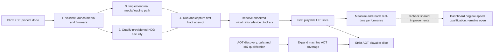

# Blinx: serial attract-sequence bring-up

**Current, 2026-10-08 (`beads-xbox.1.62`):** actual NTSC Blinx now renders
its textured 3D attract world and character. Reserved viewport constants 58/59
were missing from the HLE handoff; the original emitter and LLE NV097 register
contract qualify the correction (.89). A scalar ARL store defect in the
borrowed CPU reference also required correction (.91); all 32 captured scene
draws now agree at the existing tolerance, with independent CPU/GPU and compiled
LLE address tests. Draw-range vertex synchronization now follows Phobos's
consumed-range strategy: a same-executable uncaptured stage comparison improves
3.51427 to 13.87240 fps (3.95x), retaining real ordered GPU updates (.92).
The captured candidate renders the scene and completes 63 replay writes in a
bounded five-minute run. All 35 native tests pass. Actual enabled controller
input now interrupts rendered 3D attract, returns to the visible title screen,
and idling re-enters the demo within a bounded 330-second run (.93). Natural
end-to-end completion, repeat-loop stability and original-speed cadence remain
outstanding; JSRF remains deferred.

Earlier progression:
The borrowed Phobos renderer now presents actual game frames. The prior disc
error is traced and fixed: local VM/texture ownership caps returned out of memory
while real guest RAM remained available. Blinx now loads 420 textures, passes
visibility Begin/End, and executes its ordered GPU WRITE callback. The latest
run passes shared front-buffer texture aliases and contiguous page protection,
then reads the movies asynchronously and executes their YUV/audio path. Direct
GPU captures show both publisher logos, the opening movie and the animated
Press START screen. A 180-second guest-only one-core run continues at that
screen; the earlier timing-sensitive thread-priority stall remains open.
Two subsequent controller-replay runs interrupt startup, reach title music,
idle into game-asset loading and reach PersistDisplay. Its native implementation
now preserves the real frame and passes D3DDevice_Reset. The subsequent actual
run loads scene textures and sound banks, reaching 505 textures. Shared clock
and calendar services now pass their original-kernel/native fixtures; the next
actual run passes those calls and opens round1.adx. Flat shading now has a bounded
software floor and an actual cached GPU implementation around Phobos's pipeline.
The latest title runs pass that state and the subsequent pixel-shader query,
submit further GPU work and pass logic COPY and mapped pixel constants,
then exposed an incorrect GetPixelShader stack-cleanup binding. Correcting
it restores scene-compositing state and presents the loading screen. Phobos's
GPU feedback snapshot now passes the texture/render-output overlap and Blinx
opens 01_StageStart.adx. Borrowed Xbox ADPCM now passes the format0x69 stop;
the latest run completes more stage reads and reaches the Demo play overlay.
Asynchronous writes now complete two actual 1,913,856-byte replay files (.86).
The 420-second bounded run continues without a guard/crash; captures show the
overlay and a green effect, then mostly black frames. No rendered gameplay is
established. Tail presentation measures 0.236fps with diagnostics, far below
the cadence goal. The callback-progress fix (.87) raises the matched first 28
stage presents from 0.23515 fps to 2.94719 fps (12.53x), without image capture in
either run. Median frame time falls from 4253.97 ms to 339.97 ms. Real D3D11 event
completion remains required; allowing GetData to advance queued commands removes
the 255-poll stalls. All 34 native tests pass (14.59 s). The faster run writes
three replay files and stops after 147.11 s at an unqualified zero-byte audio
buffer request (.88). That request is now qualified as Stop, detach, Release,
then create/rebind the next sound. The captured 300-second follow-up passes
repeated detachment, completes 19 replay-file writes and opens 09_TimeStop.adx,
with no guard/fault before the harness stops it. Its last 60 presents measure
2.738 fps (capture enabled). Images still show a largely black scene behind
the overlay/effects (.89). High-resolution callback retry (.90) now improves a
fresh matched comparison from 2.92987 to 4.16574 fps, with real completion and
deadlines retained. Both 180-second observations remain free of guards/faults;
all 35 native tests pass. No complete attract-loop or original-cadence claim follows.
Captured real GP audio
matches original intro/title content at the checked sample progression.
Full audio quality/sync and attract validation remain pending. Earlier fresh/repeat runs reached the callback boundary in 12.95/7.33 s
with zero error-dialog entries or memory failures. The 64 MiB guest limit remains
enforced. No title error condition is bypassed.

| Milestone | Evidence / remaining work |
| --- | --- |
| Native launch, files, writable storage | Real startup, installed-media contract, persistent title files/cache; original optical reference retained |
| Renderer adoption and presentation | Phobos D3D11/RHI, conversions, shader/state caches and combiner pipeline integrated; real loading/error frames, Swap callbacks and GPU fences exercised |
| Audio service readiness | Real title GP output captured; intro and title-music samples match independent source decoding; full quality/sync and all attract content pending |
| Movie service readiness | Publisher/opening/title movies render; timed Start interrupts startup through original logic; complete movie/audio synchronization pending |
| Disc-error diagnosis | Actual caller returns E_OUTOFMEMORY from local 512-reservation/256-texture caps; growing ownership fixes progression to 420 textures, with real memory budget retained |
| Visibility queries | Bounded software NV2A sample/report floor, original-x86 ABI and real native GPU fixtures pass; title Begin/End progress validated, title Get not yet reached |
| Ordered GPU callbacks | Original READ/WRITE packets, bounded LLE idle/IRQ floor and native FIFO/real completion tests pass; Blinx executes its WRITE callback |
| GPU texture aliases | Actual shared Phobos RHI storage; LLE clear/sample/update and native ownership/hazard fixtures pass |
| Memory protection | Original Set/Query execution, LLE page faults and native host protection pass; actual title request succeeds |
| Movie discovery | Real directory cursor/entries and native ABI tests pass; optical transport fixture passes; complete retail filesystem behavior remains a reference gap |
| Asynchronous movie IO | Real events, nonbuffered reads and completion ownership pass; Blinx executes 29 actual read completions |
| Movie YUV state | Original enable/cache/packet oracle and bounded NV2A pixels pass; imported Phobos conversion reused |
| Persistent display | Original layout/kernel execution, LLE retained-frame scanout and native pixels/lifetime pass; actual Blinx preserves its frame and reaches Reset (.75) |
| Display reset | Original buffer/header setup, LLE scanout and repeated native reset/resize/ownership/pixel tests pass; actual Blinx proceeds through reset into scene loading (.76) |
| Clock/calendar services | Original query/retry/calendar ABI fixtures and native real-clock/conversion tests pass; actual title proceeds to round1.adx and flat shading (.77) |
| Flat shading | Original XDK provoking packet, bounded NV2A software pixels and actual native VS/PS/quad/interpolation tests; title passes prior guard (.78) |
| Pixel-shader query | Original full query and native real bind/unbind/rebind, output extent and ownership tests pass; actual title advances (.79) |
| Logic COPY | Original packets/cache, corrected bounded LLE write masks and native COPY/blend restoration pixels pass; actual title advances (.80) |
| Mapped pixel-shader constants | Original setter/getter and native GPU fixtures pass; existing Phobos uploads reused, packed query cache updated, eye vector retained; actual title advances (.81) |
| Shader restoration ABI | Corrected donor GetPixelShader stack8 to original RET4; all129 identified cleanup boundaries audited, independent caller-stack test passes; title advances (.83) |
| Empty vertex binding | Complete original/native declaration state agrees for zero and restoration; empty-format drawing stays guarded (.82) |
| Render-target feedback | Observed aligned full-screen scene pass; bounded NV2A pixels and real native snapshot/cache/lifetime tests pass; borrowed Phobos implementation advances actual Blinx (.84) |
| Xbox ADPCM buffers | Borrowed Phobos/NoRain decoder agrees with APU samples; original unit helpers and real native output/storage/cursor/loop/lifetime tests pass; actual Blinx advances (.85) |
| Async file writes | Original submission/events, LLE actual storage-before-IRQ and native write/EOF/completion/filewait/ownership pass; actual title completes two1.9MB files (.86) |
| Callback completion progress | Real completion/FIFO retained; matched stage 0.23515 to 2.94719 fps, max polls 255 to 2; 34 native tests pass (.87) |
| Audio detach/rebind | Original settings/caller, LLE VOICE_OFF and real native PCM/ADPCM output/ownership validated; actual 300-second run passes old guard and repeated sound reuse (.88) |
| Callback retry timer | High-resolution native relative wait with supported fallback; fresh matched stage 2.92987 to 4.16574 fps, all 35 tests pass (.90) |
| Attract scene geometry | Viewport reserved-constant handoff fixed; actual world and Blinx visible; original emitter, bounded LLE and 32 real draw comparisons pass (.89/.91) |
| Vertex synchronization | Phobos draw-range strategy; real partial GPU updates preserve queued contents and later mutations; uncaptured stage 3.51427 to 13.87240 fps, 35 tests pass (.92) |
| Next integration work | Validate natural attract completion and repeated loops; measure cadence and resource stability |
| Input | Actual timed host-controller Start interrupts 3D attract, returns to visible title screen, and idling re-enters demo (.93); physical controller operation remains separately unverified |
| Attract startup/loading/render/audio/movies/gameplay | Partial startup/rendering only; no complete attract sequence yet |
| Repeat loops, interruption/menu return, original cadence | Pending actual title integration measurements |
| JSRF | Deferred until Blinx completes; shared services and separate revision bindings |

The earlier callback checkpoint passed all 30 CTests (13.04 s). Current alias
ABI and LLE NV2A tests passed. The later device-recreation query timeout was
traced to a donor cached view from the destroyed device and fixed (.66). The
three-device renderer test passes with/without D3D11 validation. The latest full
suite now passes all 31 tests in 13.31 s after the async read access-rights check
was corrected. The earlier intermittent vblank handle-count assertion remains
unexplained. Visibility fixtures cover real samples, masks,
clipping, index reuse, pending outputs, timestamps and teardown. Capacity tests cover
600 simultaneous reservations and 520 GPU textures with repeat cleanup and real
contents. The concurrent validation run encountered the existing vblank test's
intermittent process-wide handle-count assertion. Private title evidence and
bounded correctness qualifications are listed in the
[pilot README](../pilots/native-title/README.md#bounded-visibility-contract).
Attribution is preserved in the [inventory](../THIRD_PARTY_ATTRIBUTION.md).
These are service milestones, not percentage-complete or an ETA. Full AOT and
dashboard performance continue without blocking title bring-up.

## Earlier optical launch investigation

**2026-10-06 native-path investigation:** the latest Phobos audit now compares
a donor-led native title build with the machine boot route tracked below.
Blinx is the primary workload. Neither
requires dashboard performance qualification first. The four-package accounting
below describes the retail-kernel optical path, not a complete estimate for the
native route. See the [measured binding gaps,
launch contracts and next steps](PHOBOS-DEEP-AUDIT-2026-10-06.md).

Updated 2026-10-04. This is a milestone burndown, not a measured calendar
forecast. Packages differ in size; counts are not percent completion.
Central Beads is the issue source of truth.

**Owner priority, 2026-10-04:** exploratory Blinx bring-up may proceed before
dashboard original-speed qualification. Dashboard slowness remains an active
objective and regression workload (`beads-xbox.1.17`); it no longer blocks
launch issue `beads-xbox.1.7.1`. Shared improvements must be checked on both
workloads; incidental dashboard speed gains are a hypothesis, not a promise.
Follow the
[LLE floor / enhanced execution gameplan](GOAL-AOT-DASHBOARD.md).
Partial AOT and the existing CPU floor are acceptable for this milestone;
every dashboard interior and zero dynarec are not additional launch prerequisites.
The dated media findings below remain launch dependencies, not newly completed work.

The [first live borrowed-renderer checkpoint](RESULTS-XEMU-PSH-2026-10-03.md)
is implemented. Its performance remains experimental and does not satisfy the
menu target. Real media/loading work now proceeds while that target remains open.

## The next Blinx milestone

**Attempt to launch Blinx through the real Xbox kernel and capture the first
guest execution or exact blocking failure.** This does not require completion
of the AOT compiler. The existing faithful CPU floor can execute the first
attempt. It does require a valid input/launch route and implemented device
behavior. No stubs, fabricated success or skipped initialization.

The recorded route has four launch packages below. A boot attempt is the next
Blinx milestone; full renderer coverage and full AOT
are not additional prerequisites.
Audio/device work can become necessary to get beyond a boot attempt into menus
or gameplay. Do not postpone the first attempt until all of those projects end.

## Burndown ledger

| Gate | Status | Completion evidence | Tracker |
| --- | --- | --- | --- |
| Pin existing Blinx XBE | Complete | NA retail, title 4D530013, XDK 4831; SHA-256 recorded in private inventory | beads-xbox.1.7.1 |
| 1. Validate launch inputs | In progress | Selected firmware and full game files/media can support a real-kernel launch; missing metadata explicitly recorded | beads-xbox.1.7.1 |
| 2. Qualify drive security | Complete for the selected launch configuration; broader drive qualification remains separate | Provisioned locked HDD unlocks on the mounted-disc kernel path and reaches optical authentication; no new security bypass | beads-xbox.1.28 |
| 3. Implement media/loading | In progress on `bringup/blinx-media-20261004` | Real sector reads, required ATAPI status/DMA/IRQs and loader behavior pass tests; no spoofed security success | beads-xbox.1.7.1 |
| 4. First boot attempt | Captured; game entry remains blocked | Real kernel sees Blinx Rev1 media and stops on DVD authentication page 0x3e after 53,516,892 instructions | beads-xbox.1.7.1 |
| Reach gameplay | Pending | New game and reproducible movement/combat/time-control route through implemented hardware | beads-xbox.1.7.2 |
| Complete playable slice | Pending | Audio, input, transition and save/reload validated | beads-xbox.1.7.2 |
| Strict AOT slice | In progress: foundations | Compiled game and kernel execute the declared post-boot route with zero CPU JIT/interpreter fallback | beads-xbox.1.25.5 |
| Real-time slice | Pending | Original-speed guest progress, distinct frames, audio and latency on the development PC | beads-xbox.1.7.2 |

Current snapshot: **2 of 4 launch packages remain open**: input/authentication
suitability and complete media/loading. A captured failed attempt is not
successful title initialization. See the [actual probe and transport validation](RESULTS-BLINX-MEDIA-AND-DASHBOARD-COST-2026-10-04.md). There is not yet a
velocity history from which to draw an honest date-based burndown line. Append
dated gate completions below; do not infer a calendar from checkboxes.

| Date | First-attempt gates remaining | Evidence |
| --- | ---: | --- |
| 2026-10-02, initial inventory | 3 | XBE inspected; runtime DVD remains no-media; no Blinx launch attempted |
| 2026-10-02, drive-contract audit | 4 | Scope increased: pre-existing unconditional HDD unlock and freeze no-op discovered; zero gates closed |
| 2026-10-02, media audit | 4 | Three images hashed and bounded filesystem trees inspected; original Blinx/JSRF XBEs match extracted copies; authentication and launch suitability remain unqualified |
| 2026-10-02, drive implementation | 4 | Provisioned authentication and explicit unlocked mode implemented; 61 tests pass; 12B dashboard replay matches reference; broader drive qualification remains open |

| 2026-10-04, actual kernel probe | 2 | Selected provisioned HDD configuration reaches optical authentication; mounted Blinx Rev1 triggers page 0x3e and an explicit unsupported stop. Game entry remains open. |

## What changes the estimate

Input suitability is the first uncertainty. The owner supplied a network share
containing full-size Blinx Rev 1 media and smaller Blinx/JSRF images, in addition
to extracted directories. The full-size Blinx image has a valid XDVDFS descriptor
and bounded directory/file extents. Its XBE differs from the previously pinned
extracted XBE: versions must remain separate qualification inputs. A readable
filesystem does not establish optical authentication behavior. Confirm the
real-kernel launch route before assigning implementation dates; missing metadata
is an input blocker, never permission to emulate successful authentication.

All three inspected XBEs declare media mask `0x00000002` (DVD-X2 only). An
unmodified launch must respect that restriction; copying the title to HDD is
not a qualified substitute. The smaller Blinx image matches the original
XDK 4831 compiler input, while Rev 1 uses XDK 5558. JSRF's image matches its
extracted XDK 4134 XBE. The complete local manifest is
`build/aot-20261002/media.aot-private.json`; source images remain unchanged.

The DVD model now supports optional read-only media and bounded real sector
transport. The observed Xbox authentication page remains unimplemented. The IDE audit found
unconditional HDD password acceptance and a freeze-lock no-op. Both were
replaced with a provisioned authentication model and stateful freeze behavior.
The old stop at 17,940,376 instructions is cleared: a provisioned retail run
completes the 12B dashboard replay without fault and matches its reference image. An explicit unlocked-drive
configuration is the owner's documented narrow exception. See the
[implemented contract and remaining qualification](HDD-SECURITY.md).
This is platform validation, not a Blinx boot attempt. The APU has limited device
behavior and no audio output. These are distinct from AOT compiler coverage.
The first boot trace establishes which missing behaviors actually block Blinx.

Report three dates separately when evidence permits a forecast: first attempt,
first playable LLE, and performant strict AOT. A failed but fully instrumented
first attempt can close gate 4, but cannot close successful kernel launch or
gameplay. Keep the owning issue open until its acceptance criteria pass.

## AOT work already underway

- An XBE inventory records static instructions, unresolved transfers and
  unclassified section bytes without emitting certificate secrets or game code.
- General guest CALL/RET, register/constant PUSH and register POP now have
  authored and differential checks, including interrupted calls and flags.
- An isolated ten-instruction path across two Blinx code regions passes O0/O2
  with matching architectural state and all 64 MiB RAM at every prefix, and zero
  fallback inside its explicitly warmed scope. This is not a kernel/game boot.
- A test-only x87 helper experiment checks existing extended-precision
  arithmetic outside JIT execution; production x87 integration remains open.
- No donor runtime has been transplanted. Rejected paths include control-register
  stubs, unimplemented-op continuation, and forced DSP acknowledgements.

HLE can replace any reached subsystem once an implemented LLE counterpart and
its observable contract exist. Enhanced profiles may enable it by default with
an explicit reference opt-out. Native internals can differ, and numerical or
presentation differences use documented per-contract tolerances. Required
memory effects, errors, ordering and resource ownership remain compatible;
ABI call signatures alone do not establish that. A missing reference behavior
is an actual implementation gap, never permission to report fabricated success.
