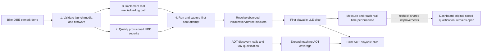

# Blinx: serial attract-sequence bring-up

## LLE contract hardening burndown - 2026-10-08

Tracked in `beads-xbox.1.102`; baseline is the committed working attract
milestone below. Follow [recomp-template HLE.md](../../../recomp-template/HLE.md)
verbatim: LLE is the maintained correctness foundation; HLE is its performance
replacement under the caller-visible contract. A working HLE implementation
does not remove the requirement to implement and maintain its LLE counterpart.
Original-code fixtures, xemu comparisons and plausible output provide evidence;
they do not substitute for our working LLE route.

There are **nine scoped service-family acceptance gates** in this phase. Every
family already has some implementation/test coverage, but that does not establish
a complete LLE route for each native replacement. Each closes only after its
LLE route, independent qualification and matching HLE contract are recorded.
This is not an estimate of missing implementation, a percentage of Xbox emulation,
or a calendar forecast.
The actual family count starts at **9 open / 0 closed** on 2026-10-08;
the bounded controller-input, display, memory and filesystem gates now bring it
to **5 open / 4 closed**.
The owner requested **serial delivery from least complex to most complex**.
On 2026-10-09 the owner explicitly moved **all work requiring a real console
to the back of this burndown**. Continue independent LLE implementation and
qualification offline instead of blocking the entire list on hardware access.
Scheduling/events/timers (`.112`) is the next active family. GPU startup and
its prepared hardware observation remain open and deferred, not waived.
Calendar conversion is the first small slice of the scheduling/time family;
finishing it does not close that larger family. These ten delivery entries and
nine acceptance gates deliberately use different granularity.

Owner follow-up: bundle related LLE cases that share setup/reference state,
including coherent dependency chains within the active family. Run focused
checks during implementation, one combined qualification pass, and one actual
Blinx regression per coherent batch. Retain explicit outcomes for each contract;
a bundled pass does not close an unimplemented service. Reuse captured evidence
and avoid repeating whole attract runs for documentation or test-only changes.

Dashboard support and real persistent HDD/save storage remain architectural
requirements, including a supported user choice of dashboard or accelerated
launch. Missing dashboard assets must not remove console storage. Completion of
all dashboard polish/performance work is not a Blinx bring-up gate. See the
[console launch/storage contract](CONSOLE-LAUNCH-STORAGE.md) and existing
provisioning issue `.22`; the native host-directory backend has not completed
the shared virtual-HDD requirement.
Owner follow-up: keep direct-to-game launch, consider an optional permissive
open-source default dashboard, and preserve the supplied retail boot experience
including its original logo sequence. Make console/save targets configurable
and design for multiple recomps sharing one real save drive/profile. These are
tracked in `.22` and the console contract; they do not restart dashboard work or
change the next controller-input dependency batch.

| Delivery order | Service | Relative work / dependencies | State |
| --- | --- | --- | --- |
| 1 | Pure calendar conversion (scheduler/time slice) | Small: two original kernel routines; no hardware, IRQ or queue state | Complete, `.103`: both builds qualified; both original routines execute in actual Blinx, with interruption/menu return and reentry; [evidence](../pilots/native-title/CALENDAR-LLE.md) |
| 2 | Controller input and interruption | XID reports plus USB initialization, DMA and interrupt dependencies | Complete for bounded Blinx port-0 automatic input, `.104`: actual original and HLE interruption/title/reentry, original and HLE hotplug/reopen/Start, original report/mask oracles, shared DMA lifetime and capability transport. 46/46 LLE and 40/40 HLE tests pass. Broader peripheral/timing scope remains explicit. [Evidence and limits](../pilots/native-title/INPUT-LLE.md) |
| 3 | Display clock and vblank | Bounded clock/interrupt/callback family | Complete for bounded Blinx display, `.105`: original driver/NV2A/PIC route, scanout and three device lifetimes qualified; combined original input/display reaches Demo, interruption, reentry and subsequent movie in 510s; final game-owned native regression passes. Phase/other modes remain explicit. [Evidence](../pilots/native-title/DISPLAY-LLE.md) |
| 4 | Memory and resource lifetime | Cross-cutting pointer, page, alias and ownership semantics | Complete for bounded Blinx memory, `.106`: original allocation/query/residency/relocation and shared CPU/DMA/resource lifetimes; 50 original cases, 46/46 LLE tests, 300s LLE-memory and 190s native attract regressions. The earlier native 39/40 event-timeout assertion `.99` is corrected by the scheduling batch below; long-run host retention remains `.107`. [Evidence and limits](../pilots/native-title/MEMORY-LLE.md) |
| 5 | Files, cache and installed media | File bytes/errors/order plus backing storage and mount lifetime | Complete for bounded Blinx files, `.108`: actual original Nt/FATX/cache/IDE title route, whole-XBE comparison, two-process persistence, 84 original metadata/directory/error/namespace cases and 64 real lifetimes. HLE corrections pass 40/40 game tests and a 190.109s Demo/interruption/title/reentry regression. Explicit resource/metadata tolerances and guarded unqualified modes remain. [Evidence and scope](../pilots/native-title/FILES-LLE.md) |
| 6 | Remaining scheduling, threads, events and timers | Coupled ready/block/wake/preemption and interrupt state | Active `.112`: original event lifecycle/polls and timer insertion/cancellation now pass in the maintained bridge; 47/47 mixed tests and a 190.235s Blinx regression pass. Original expiry/wakeup and complete scheduling remain open. [Scope and evidence](../pilots/native-title/SCHEDULING-LLE.md) |
| 7 | Audio buffers, cursor, routing and lifetime | APU/DSP plus DMA, scheduling, reuse and output | Open; continue executable/reference work offline, defer any unresolved hardware observations |
| 8 | GPU completion, callbacks and visibility: independent offline work | FIFO/traps/reports, pending results and lifetime; uses memory/display | Partial `.109`: original queries/fences, 228 IRQ/DPC callbacks, hardware-referenced 2D pixels and bounded 3D/texture/encoder cases pass. Full original title startup and dependent integration remain open; their real-console observation is at the end of this list. Do not repeat that blocked startup experiment while working on independent services. [Evidence and limits](../pilots/native-title/GPU-COMPLETION-LLE.md) |
| 9 | Graphics state, shaders, textures and vertex fetch | Broad NV2A draw/state/format coverage; uses memory/completion | Open |
| 10 | Movie/A-V sequence integration | Composes the qualified file, decoder, input, audio and display paths | Open |
| Last | Real-console observations and the integration they unblock | GPU startup/FD6806A0 `.111`, followed by any other specifically identified hardware-only questions | Deferred by owner. Probe `a22bb74` is prepared, not executed. Keep affected family gates open; revisit after available offline work or when the owner supplies evidence/authorization |

This is a relative work ranking, not a date forecast. Work serially through
the available offline entries. For each, implement the executable LLE route,
record independent evidence and HLE comparison, and regress actual Blinx where
the changed service is connected. When an issue genuinely requires a console,
record its exact question and dependency at the end and continue the next
independent entry. Deferral does not count as qualification or permit guessed
device results. The final row is a deferred-work queue, not a tenth family.

GPU startup's unresolved FD6806A0 transaction now has a prepared, bounded
hardware observation in `.111` (probe branch `feat/av-handshake-probe-20261009`,
commit `a22bb74`). All 17 offline checks and the XBE build pass; hardware
deployment/execution awaits explicit current-task authorization. Preparation
does not qualify the transaction or close a family. This observation is now
deferred behind independent offline families by the owner's 2026-10-09 order.

GPU callback delivery has now advanced independently of startup: original
InsertCallback/kick, PIC/kernel interrupt gate, ISR/DPC and IRET pass 228 actual
callbacks across three lifetimes. Held work, interrupt masking, original
disconnect/reconnect, 70-callback bursts, context/order/IRQL and final allocation
statistics are checked. Matching HLE graphics/scheduler checks pass 2/2. This
closes the standalone callback-delivery gap, not the original title startup or
full GPU-family gate; no production changes or fresh attract run are claimed.
See the [GPU evidence and remaining limits](../pilots/native-title/GPU-COMPLETION-LLE.md#original-interrupt-driven-callback-qualification---2026-10-09).

The maintained LLE renderer now connects bounded 3D color/depth surfaces to the
existing tile/compression memory path. Eight configurations check actual pixels,
depth, masks, 696 visibility samples and physical FIFO/report DMA; unsupported
tiled texture/vertex inputs still stop. A newly reproduced failed-fetch bug is
fixed: later reports cannot publish the old sample count as completed work.
The actual LLE Blinx launch still stops before frames at encoder startup state;
this does not close the GPU family. [Latest evidence](../pilots/native-title/GPU-COMPLETION-LLE.md#tiled-3d-surface-clients---2026-10-09).

Bounded tiled ARGB/XRGB texture sampling now follows those surfaces: blit, sample,
3D update and sample-again cases pass across matching bank/DMA configurations.
The same work fixed raw linear row pitch and XRGB sampled alpha in the LLE
sampler. Phobos-backed HLE passes the equivalent padded-image/alpha/GPU-update
contract without a production change. Other tiled texture layouts remain guarded;
this is modeled composition, not a new hardware texture golden. Actual title
startup still stops at the encoder-state guard and the count remains **4/9**.
[Latest texture evidence](../pilots/native-title/GPU-COMPLETION-LLE.md#tiled-color-textures-and-matching-native-sampling---2026-10-09).

Encoder reset no longer requires an artificially aligned GPU sync phase. Actual
incoming HSYNC/VSYNC drives FIELD with the documented two-clock delay, including
VSYNC preceding HSYNC. Scheduled events, the existing GPU timing component and
original kernel FIELD calls pass; uncertain transient color phase stays unknown.
The actual LLE title still stops before frames at the same encoder-state guard.
This closes a timing-component limitation, not startup or the GPU family: **4/9**.
[Evidence](../pilots/native-title/GPU-COMPLETION-LLE.md#encoder-reset-between-incoming-sync-edges---2026-10-09).

| Family gate (stable identifiers, not delivery order) | Existing evidence to retain | Required LLE route and qualification | Reference to use first |
| --- | --- | --- | --- |
| 1. Controller input and interruption | Host conversion/ABI tests; previous real attract interruption/menu-return/reentry; owner keyboard observation | Independently qualify connected/disconnected reports, packet/button semantics and lifetimes; repeat controlled Start interruption and idle reentry on the final hardened build. Physical-controller details beyond the exercised contract remain separate. | Original XAPI/XID behavior and xemu; actual controller/hardware capture when an input-report question cannot be settled independently |
| 2. Display clock and vblank | Original display and cadence fixtures; software PCRTC/FIFO independence; native callback and unregister tests | Qualify present/vblank sequencing, callback lifetime and waits while GPU work is stalled. Preserve the original nominal cadence without requiring identical host frame times. | Original driver code plus software PCRTC and xemu; hardware capture for disputed scanout/phase behavior |
| 3. Memory and resource lifetime | Native VM/physical-memory/alias/Reset tests; original stream-binding and ownership fixtures | Audit exercised pointer namespaces, protection and ownership transitions; demonstrate coherent CPU/resource access, retained lifetimes and destruction with independent expected results. Arbitrary physical aliases/DMA are currently unqualified. Do not reopen the deferred New Game bug in this phase. | Original kernel/XDK operations and existing MMU/unified-memory floor; xemu full-system execution when isolated CPU fixtures cannot cover the path |
| 4. Files, cache and installed media | Real bytes/EOF/position/directory tests; async event/IOSB/data ordering, close/reopen lifetime and installed-media identity tests | Match exercised success/failure/short-read/close behavior to the original API; verify replay writes and repeated mount/cache lifetimes. Retain the approved installed-media authentication exception and optical reference as distinct policies. | Original kernel/XAPI in CPU fixtures or xemu; hardware only for a relevant device-specific uncertainty, not to restore waived optical authentication |
| 5. GPU completion, callbacks and visibility | Software NV2A visibility/report and FIFO tests; native 70-callback FIFO, actual pixels, pending-result and teardown tests | Trace the original command boundary through FIFO/trap/report/completion and test that required ordering holds without unnecessary CPU waits. Add pending/error/reuse cases only where the current exercised contract lacks evidence. | Original XDK packets plus xemu NV2A behavior; hardware microtest/golden result for unresolved ordering or sample-count semantics |
| 6. Scheduling, threads, events and timers | Original-kernel ready-queue/base-priority fixture; native exclusive guest CPU, suspend/resume and real wait tests | Bound the title's ready/block/wake/preemption paths and callback eligibility. Separate original rules from provisional 2-ms host scheduling policy; dynamic boosts and exact interrupt/quantum timing remain unqualified. | Original kernel first; kernel execution/traces in xemu for coupled paths; hardware if actual timing affects guest-visible results |
| 7. Audio buffers, cursor, routing and lifetime | ADPCM/cursor/detach references; native real output/mixer tests; all 7,560 captured opening submissions match original guest PCM | Tie cursor, stop/detach, buffer reuse and completion to bounded APU behavior; retain actual output tests and document resampling tolerance. A healthy native queue alone is not proof of original transport semantics. | Original DirectSound caller/settings plus APU/xemu behavior; hardware for disputed timing/routing. Compare original decoder PCM, not an assumed bit-identical independent ADX decoder |
| 8. Graphics state, shaders, textures and vertex fetch | Real native draw/readback fixtures; software NV2A and shader cases; 32 captured scene draws previously compared | Match the exercised register/draw cases to independent expected pixels/state; cover persistent-pointer writes, aliasing and relevant shader edges. Audit shared reference helpers so correlated errors do not count as independent agreement. | Published NV2A hardware goldens, original command emission and xemu; new hardware cases only for missing/disputed behavior |
| 9. Movie/A-V sequence integration | Original guest Sofdec/ADX decoding retained; sampled video progression and PCM/submission/mixer captures | Verify final-frame/transition timing, interruption and repeated A/V alignment within justified tolerances. Exercise the combined file/audio/display contracts; no separate invented hardware movie decoder is required. | Original decoded data and timestamps, xemu same-title sequence; hardware recording when authentic transition/relative timing remains ambiguous |

For **every row**, map the HLE caller interface to an executable LLE route using
original low-level program/device behavior. Connect and complete that route where
it is missing, even if the HLE version already looks correct. Record maintained
source, build selection and an actual execution command. A build option that
selects original code but stops at an unimplemented dependency is not a working
floor. The movie row composes the real decoder, storage, audio and display routes;
it does not invent a hardware codec absent from the original system.

Work in the revised delivery order above. Qualify independent services while
console-dependent questions are deferred; keep integrations open where their
actual required dependencies remain unqualified. Control cost by reusing existing LLE implementations and
qualified cases, bounding the supported service inputs honestly, and avoiding
unrelated console features. Do not optimize LLE for real-time playback. Keep both
builds working as the shared interface evolves; select implementations at build
time, including per-family selection when useful. No runtime HLE selector,
automatic live fallback, duplicate production execution or state migration is
required. HLE does not reproduce private LLE state or internal operations unless
an actual caller observes them.

The nine gates are unweighted and can vary substantially in effort. Accepted
28.5-28.8 fps debt remains `.100`, outside this phase's closure condition.

### How evidence is selected

1. **Define the question at the observable boundary.** Record arguments,
   return/error values, memory effects, ownership, ordering and observable
   completion. HLE execution identifies the inputs/cases, not the correct answer.
2. **Use original code for software contracts.** Run hash-bound owned kernel/XDK
   routines unmodified when their dependencies fit a bounded CPU fixture. If
   the test would need fabricated dependencies, execute a larger real path in
   the system reference instead. CPU fixtures do not prove device timing or a
   complete local LLE subsystem.
3. **Use xemu to understand and reproduce device behavior.** Its guest debugger
   and trace events expose original-code/device interactions. Record the commit,
   image/kernel identity, settings and trace. The current local source checkout
   is `482088490c2d5983ed5e1eafbd09906157c1eca0`; any newly used revision must be
   recorded separately. No new xemu runtime comparison was executed for this
   planning update. Source inspection is not a differential test result.
4. **Use hardware evidence for silicon and disputes.** Consult existing matching
   hardware goldens first. Escalate to a small reproducible probe if references
   disagree, the behavior is undocumented, or host emulation timing cannot settle
   it. Capture board/kernel/title/test revisions and measurement limits. Do not
   vote among implementations or treat xemu's host FPS as console timing.
5. **Maintain our executable LLE floor, then test HLE against its contract.**
   Implement missing LLE routes whether or not an HLE defect is visible. Build
   and run the selected LLE implementation; use the references above to qualify
   it independently. HLE may inform test inputs and implementation hypotheses,
   but cannot establish LLE correctness by itself.
   Shared helpers and copied expectations can conceal the same defect in both
   paths. Keep their provenance visible. xemu/Theseus GPL implementation bodies
   remain outside the intended non-GPL product; behavioral findings and test
   provenance are recorded. Phobos supplies HLE implementation strategies, not
   the sole correctness oracle.

A row closes only when (1) the shared supported contract is recorded, (2) its
maintained LLE build actually performs that service within the declared scope,
(3) independent evidence qualifies the LLE behavior, (4) the HLE build meets the
same caller I/O/effect contract within documented tolerances, and (5) actual Blinx
attract regression passes after integration changes. A slow LLE route is valid;
an absent route cannot be replaced by an HLE-only test or a golden-output file.
Known inaccuracies remain explicit. Exhaustive hardware fidelity and matching
internal HLE execution are not prerequisites. Reuse saved reference fixtures and
run focused checks for changes rather than repeatedly running broad matrices.

References: xemu documents [guest debugging and device tracing](https://xemu.app/docs/dev/debug/guest/)
and recommends [NV2A hardware comparison tests](https://xemu.app/docs/dev/debug/graphics/).
The [nxdk_pgraph_tests suite](https://github.com/abaire/nxdk_pgraph_tests) links
golden results from real Xbox hardware. Our local reference entry points include
`tools/native_scheduler_reference.py`, `tools/native_stream_binding_reference.py`,
`tools/native_display_reference.py`, `tools/native_audio_detach_reference.py`,
`tools/native_adpcm_cursor_reference.py`, `tools/native_file_write_reference.py`,
`tests/test_nv2a.cpp` and the native `*_contract_test.inc` fixtures.

Real-hardware access is separately governed by standing issue `beads-xbox.1.12`:
no contact/deploy/launch/read/write without current-task authorization. This plan
uses existing local/public evidence first and does not contact the console.

## Working attract milestone - 2026-10-08

Owner observation confirms the NTSC Blinx FMVs and real-time Demo play look
correct and run end to end. Preserve this as a functional/visual milestone on
`milestone/blinx-attract-20261008`, runtime commit `318f5ac`, rather than treating
it as completion of every original acceptance criterion. The copied executable
left open for the owner has SHA-256
`d8aa47e8c56c807ca9e046d11408b1686209bf9abb32da7fffb060d49c61f7a7`.
All 37 native tests pass on that runtime; no new source changes were made for
this milestone record. The owner's second idle observation has no logged
terminal guard at the recorded snapshot. Live log phase opens alone are not
counted as verified completed loops.

| Sign-off item | Current conclusion |
| --- | --- |
| Startup, movies, title screen, real-time attract gameplay | Working visual milestone, including owner observation |
| Natural repetition | Two complete natural demos and a third rendered entry captured on the preceding scheduler candidate; current runtime has complete-stage A/B runs and owner idle observation |
| Input interruption and menu return | Captured on the preceding scheduler candidate; repeat the controlled check when qualifying the final reference/HLE contract set |
| Intended gameplay cadence | Owner accepts 28.52/28.78 fps and intermittent stalls as documented performance debt (.100), not a blocker for this functional milestone; nominal 30 fps remains the target |
| Audio/movie timing | Original PCM-to-submission transport and sampled picture/audio progression have evidence; final-frame timing and complete repeat A/V tolerance remain open |
| Long-term resources | Bounded repeated observations exist; a slow leak is not ruled out by the existing samples |
| New Game/save | Confirmed guest-memory fault after save creation (.101), explicitly outside this milestone and deferred |

Next phase (.102) completes and qualifies the maintained LLE routes beneath the
**already exercised** HLE families before expanding into New Game. A functioning
HLE path still requires its LLE foundation. Follow the least-complex-first
serial delivery order above, starting with pure calendar conversion, then input.
Retain existing memory/GPU, file, scheduling and output checks. For each family record: observable input/output and memory/completion
effects, current runnable floor, independent evidence, tests and remaining gaps.
Prefer existing original-code fixtures and software LLE; use xemu behavior and
other independent references where they resolve a concrete unknown. Phobos
remains the HLE donor reference, with attribution retained.

HLE observations identify required cases and candidate boundaries; they do not
establish the expected answer. Establish that independently, maintain the actual
LLE implementation, and compare the native implementation at the same boundary.
Implement absent LLE routes even when HLE output already looks correct; repair
existing implementations when independent evidence finds a mismatch. Rerun
actual attract behavior after changes.
Exhaustive hardware fidelity, dashboard work and instruction-identical HLE are
not prerequisites for this bounded phase. No live switching or duplicate
production execution is introduced. Performance follow-up (.100) remains open with the owner-accepted current rate;
it does not block the LLE contract phase. Intermittent stalls may expose a
contract error or unnecessary synchronization, but that causal link is not yet
proved. Broader A/V qualification remains open; JSRF remains deferred. Existing
private-pilot licensing restrictions remain.

**Deferred stream uploads (.100):** the original NTSC binding contract and
actual GPU draw tests qualify consuming vertex data at draw time, following
Phobos's strategy. Removing redundant whole-resource copies at stream binding
improves complete-stage rates **27.00 -> 28.78 fps** and **27.88 -> 28.52 fps**
in two opposite-order pairs. Each stage finishes 2,329 presents and 75 writes;
all 37 native tests pass. Host load is uncontrolled and steady 30 fps remains
unmet. Evidence and scope are in the [native pilot](../pilots/native-title/README.md).
Branch `perf/blinx-deferred-stream-upload-20261008` remains isolated from the
baseline runtime while repeated-attract/input/A-V validation continues.

**Owner playtest:** the visible title screen is confirmed. New Game/save then
faults at guest `0x85BD0000` after successful save metadata/image writes; cause
is unproven. This is tracked in `.101` and explicitly deferred until attract
sign-off. A separate idle instance is left open; current work remains Blinx's
attract sequence, with JSRF still deferred.

**Audio-tail finding (.98):** exact caller-write and XAudio2-submission capture
shows that the fixed quiet-tail difference against FFmpeg already exists in
Blinx's original decoded PCM. All 7,560 opening submissions match the ring;
the actual mixer output also preserves the quiet tail. No playback correction
is justified for this comparison difference. The
[movie audit](BLINX-MOVIE-STALL-AUDIT-2026-10-08.md) records the evidence and
remaining video timing/cadence limits. This diagnostic work is isolated on
`investigate/blinx-audio-ingress-20261008`; baseline runtime is unchanged.

The same candidate now completes two natural demos in a 600-second neutral
repeat and renders a third, with 193/193 writes, 60 captures and no logged
terminal guard/fault. Whole-stage rates are **28.27 / 28.56 fps** against the
nominal 30 fps target. Third-cycle movie memory is flat at 649.60 MiB over
three samples; gameplay peaks still need longer comparable-phase observation.
The [native pilot](../pilots/native-title/README.md) records limits and evidence.
Next work remains the measured gameplay stalls and final video timing; this
audio comparison finding does not satisfy the complete Blinx goal.

**New scheduler candidate (.71):** Phobos `05040ec`'s ADX priority/resume
analysis now informs a native single-CPU execution scheduler, bounded by
unmodified original-kernel ready-queue/priority tests. With identical executable,
local media and unrestricted host affinity, scheduler-off stalls after the
opening; scheduler-on advances through the title movie. A separate 330-second
visible run confirms gameplay, Start interruption, Press START and rendered
reentry, with 63/63 completed writes and no terminal guard/fault. The candidate
is startup opt-in on `fix/blinx-priority-scheduler-20261008`; speed and complete
repeat qualification remain open. No donor timeout escape is adopted. See the
[native pilot](../pilots/native-title/README.md) for scope and private evidence.
The full-stage comparison measures 28.71 fps for the CPU-pinned reference,
25.06 for the first scheduler, and 27.87 after adopting Phobos's narrower
renderer-wait boundaries. All finish 2329 presents and 75 writes; the final
candidate retains the reference's 27186 ordered callback contexts. This is
a correctness option with a measured performance cost, not a speed win.
The final narrowed version also preserves visible controller interruption,
menu return and rendered reentry in a separate 190-second run, with 92/92
completed writes and no terminal guard/fault. The CPU-pinned runtime remains
the performance baseline; the scheduler branch is retained for correctness
and future optimization. JSRF remains deferred.

**Latest investigation (.98):** bounded tracing finds a full native audio queue
and timely cursor polling while fresh guest PCM writes stall alongside presents.
Null logging and a same-executable event-trace off/on pair do not establish a
speed fix. Removing guest CPU affinity reproduces the old post-movie priority
stall (.71). These experiments remain on `investigate/blinx-audio-tail-20261008`;
see the [audit](BLINX-MOVIE-STALL-AUDIT-2026-10-08.md) for evidence and limits.
Three full local-media observations retain sampled opening audio alignment
through second 72; the latter two reduce fresh-write gaps to about 22 ms.
The tail mismatch remains. A visible 260-second run confirms rendered gameplay
and input return to Press START; second-demo rendering is not captured.
Latest Phobos `05040ec` supplies a directly relevant shared priority/suspend
scheduler candidate for `.71`, subject to removing its timeout escapes.

**Current A/V blocker (.73/.98):** the display-event wait now returns independently
of renderer ownership, removing a measured 0.4-0.8-second lock delay from the
audio producer. The software LLE PCRTC/FIFO test and native ABI regression
qualify that separation; all 35 native tests pass. A full movie observation with
per-buffer logging disabled reaches opening frame 2263 in 76.397 seconds, with
matching sampled pixels and constant audio alignment through source second 70.
An 84.9-ms late audio shift, unmatched low-level tail audio and intermittent
video stalls remain. A separate captured run preserves input interruption,
visible menu return and rendered reentry, with 73/73 writes. Full A/V and
original-speed qualification remain open. See the native-pilot README for
evidence and diagnostic limits; synchronous audio tracing perturbs playback.

**Latest measured speed (.97):** keeping CPU-exposure state on the texture
owner removes redundant whole-table searches. Same-executable first-stage
cadence improves **23.71334 to 26.41506 fps** (+11.39%) over all 2328 intervals;
both runs naturally finish with 2329 presents, the same callback-context sequence
and 75/75 completed writes. The opening 300 intervals reach 30.00556 fps, but
whole-stage original speed remains short. All 35 native tests and the bounded
NV2A regression pass. A separate captured 180-second run preserves input
interruption, visible menu return and rendered reentry, with 68/68 writes and
no guard/fault. Full A/V synchronization remains open; JSRF remains deferred.

**Current, 2026-10-08 (`beads-xbox.1.62`):** actual NTSC Blinx now renders
its textured 3D attract world and character. Reserved viewport constants 58/59
were missing from the HLE handoff; the original emitter and LLE NV097 register
contract qualify the correction (.89). A scalar ARL store defect in the
borrowed CPU reference also required correction (.91); all 32 captured scene
draws now agree at the existing tolerance, with independent CPU/GPU and compiled
LLE address tests. Draw-range vertex synchronization now follows Phobos's
consumed-range strategy: a same-executable uncaptured stage comparison improves
3.51427 to 13.87240 fps (3.95x), retaining real ordered GPU updates (.92).
The captured candidate renders the scene and completes 63 replay writes in a
bounded five-minute run. All 35 native tests pass. Actual enabled controller
input now interrupts rendered 3D attract, returns to the visible title screen,
and idling re-enters the demo within a bounded 330-second run (.93). A subsequent
900-second observation completes two natural 3D demos, plays the intervening
movie/title sequences and enters a third demo, without guard/fault. Comparable
gameplay private memory stays around 752-753 MB and handles 607/605/605; all
193 writes complete. Full audio/frame synchronization and original-speed
cadence remain outstanding; JSRF remains deferred.

The subsequent frame-service investigation (.94) identifies repeated disabled
diagnostic environment lookups as a major draw cost. Applying Phobos's cached
configuration approach improves the same-executable first 300 gameplay
intervals from 13.71919 to 21.18739 fps (1.544x), with median intervals
65.0012 to 40.9403 ms and the same 3600 callback-context sequence. Both
capture-disabled 120-second observations have no guard/fault before harness
termination. This is measured progress toward cadence, not original-speed
qualification across the whole attract sequence.
The same build then passes a 210-second visible interruption/menu-return/reentry
observation, 45/45 completed replay writes and 32 actual draw comparisons at
the existing CPU/GPU reference tolerance.

Native GPU completion events (.95) now wake the callback worker without waiting
for the next polling deadline. Actual query completion and FIFO ordering remain
required. The same-executable first 300 gameplay intervals improve from
21.73658 to 27.88042 fps (1.283x); all 35 native tests with the D3D debug layer
and the bounded LLE ordering regression pass. A 600-second observation completes
two natural demos/movie cycles and enters a third, with 195/195 completed writes,
bounded resources and no guard/fault. A separate 180-second run validates input
interruption, visible menu return and rendered reentry on this build. The full
captured stages average 23.82/22.16 fps, so the cadence gap remains.

Original NTSC pacing fragments (.96) and read-only observation of the running
title establish two display ticks per attract gameplay frame: **nominal 30 fps**
under the current 60 Hz display contract. The original-code fixture covers 256
state values and 1024 pre-Swap gate cases. This qualifies the application target,
not exact hardware timing or complete simulation/audio/video synchronization.

Earlier progression:
The borrowed Phobos renderer now presents actual game frames. The prior disc
error is traced and fixed: local VM/texture ownership caps returned out of memory
while real guest RAM remained available. Blinx now loads 420 textures, passes
visibility Begin/End, and executes its ordered GPU WRITE callback. The latest
run passes shared front-buffer texture aliases and contiguous page protection,
then reads the movies asynchronously and executes their YUV/audio path. Direct
GPU captures show both publisher logos, the opening movie and the animated
Press START screen. A 180-second guest-only one-core run continues at that
screen; the earlier timing-sensitive thread-priority stall remains open.
Two subsequent controller-replay runs interrupt startup, reach title music,
idle into game-asset loading and reach PersistDisplay. Its native implementation
now preserves the real frame and passes D3DDevice_Reset. The subsequent actual
run loads scene textures and sound banks, reaching 505 textures. Shared clock
and calendar services now pass their original-kernel/native fixtures; the next
actual run passes those calls and opens round1.adx. Flat shading now has a bounded
software floor and an actual cached GPU implementation around Phobos's pipeline.
The latest title runs pass that state and the subsequent pixel-shader query,
submit further GPU work and pass logic COPY and mapped pixel constants,
then exposed an incorrect GetPixelShader stack-cleanup binding. Correcting
it restores scene-compositing state and presents the loading screen. Phobos's
GPU feedback snapshot now passes the texture/render-output overlap and Blinx
opens 01_StageStart.adx. Borrowed Xbox ADPCM now passes the format0x69 stop;
the latest run completes more stage reads and reaches the Demo play overlay.
Asynchronous writes now complete two actual 1,913,856-byte replay files (.86).
The 420-second bounded run continues without a guard/crash; captures show the
overlay and a green effect, then mostly black frames. No rendered gameplay is
established. Tail presentation measures 0.236fps with diagnostics, far below
the cadence goal. The callback-progress fix (.87) raises the matched first 28
stage presents from 0.23515 fps to 2.94719 fps (12.53x), without image capture in
either run. Median frame time falls from 4253.97 ms to 339.97 ms. Real D3D11 event
completion remains required; allowing GetData to advance queued commands removes
the 255-poll stalls. All 34 native tests pass (14.59 s). The faster run writes
three replay files and stops after 147.11 s at an unqualified zero-byte audio
buffer request (.88). That request is now qualified as Stop, detach, Release,
then create/rebind the next sound. The captured 300-second follow-up passes
repeated detachment, completes 19 replay-file writes and opens 09_TimeStop.adx,
with no guard/fault before the harness stops it. Its last 60 presents measure
2.738 fps (capture enabled). Images still show a largely black scene behind
the overlay/effects (.89). High-resolution callback retry (.90) now improves a
fresh matched comparison from 2.92987 to 4.16574 fps, with real completion and
deadlines retained. Both 180-second observations remain free of guards/faults;
all 35 native tests pass. No complete attract-loop or original-cadence claim follows.
Captured real GP audio
matches original intro/title content at the checked sample progression.
Full audio quality/sync and attract validation remain pending. Earlier fresh/repeat runs reached the callback boundary in 12.95/7.33 s
with zero error-dialog entries or memory failures. The 64 MiB guest limit remains
enforced. No title error condition is bypassed.

| Milestone | Evidence / remaining work |
| --- | --- |
| Native launch, files, writable storage | Real startup, installed-media contract, persistent title files/cache; original optical reference retained |
| Renderer adoption and presentation | Phobos D3D11/RHI, conversions, shader/state caches and combiner pipeline integrated; real loading/error frames, Swap callbacks and GPU fences exercised |
| Audio service readiness | Real title GP output captured; intro and title-music samples match independent source decoding; full quality/sync and all attract content pending |
| Movie service readiness | Publisher/opening/title movies render; timed Start interrupts startup through original logic; complete movie/audio synchronization pending |
| Disc-error diagnosis | Actual caller returns E_OUTOFMEMORY from local 512-reservation/256-texture caps; growing ownership fixes progression to 420 textures, with real memory budget retained |
| Visibility queries | Bounded software NV2A sample/report floor, original-x86 ABI and real native GPU fixtures pass; title Begin/End progress validated, title Get not yet reached |
| Ordered GPU callbacks | Original READ/WRITE packets, bounded LLE idle/IRQ floor and native FIFO/real completion tests pass; Blinx executes its WRITE callback |
| GPU texture aliases | Actual shared Phobos RHI storage; LLE clear/sample/update and native ownership/hazard fixtures pass |
| Memory protection | Original Set/Query execution, LLE page faults and native host protection pass; actual title request succeeds |
| Movie discovery | Real directory cursor/entries and native ABI tests pass; optical transport fixture passes; complete retail filesystem behavior remains a reference gap |
| Asynchronous movie IO | Real events, nonbuffered reads and completion ownership pass; Blinx executes 29 actual read completions |
| Movie YUV state | Original enable/cache/packet oracle and bounded NV2A pixels pass; imported Phobos conversion reused |
| Persistent display | Original layout/kernel execution, LLE retained-frame scanout and native pixels/lifetime pass; actual Blinx preserves its frame and reaches Reset (.75) |
| Display reset | Original buffer/header setup, LLE scanout and repeated native reset/resize/ownership/pixel tests pass; actual Blinx proceeds through reset into scene loading (.76) |
| Clock/calendar services | Original query/retry/calendar ABI fixtures and native real-clock/conversion tests pass; actual title proceeds to round1.adx and flat shading (.77) |
| Flat shading | Original XDK provoking packet, bounded NV2A software pixels and actual native VS/PS/quad/interpolation tests; title passes prior guard (.78) |
| Pixel-shader query | Original full query and native real bind/unbind/rebind, output extent and ownership tests pass; actual title advances (.79) |
| Logic COPY | Original packets/cache, corrected bounded LLE write masks and native COPY/blend restoration pixels pass; actual title advances (.80) |
| Mapped pixel-shader constants | Original setter/getter and native GPU fixtures pass; existing Phobos uploads reused, packed query cache updated, eye vector retained; actual title advances (.81) |
| Shader restoration ABI | Corrected donor GetPixelShader stack8 to original RET4; all129 identified cleanup boundaries audited, independent caller-stack test passes; title advances (.83) |
| Empty vertex binding | Complete original/native declaration state agrees for zero and restoration; empty-format drawing stays guarded (.82) |
| Render-target feedback | Observed aligned full-screen scene pass; bounded NV2A pixels and real native snapshot/cache/lifetime tests pass; borrowed Phobos implementation advances actual Blinx (.84) |
| Xbox ADPCM buffers | Borrowed Phobos/NoRain decoder agrees with APU samples; original unit helpers and real native output/storage/cursor/loop/lifetime tests pass; actual Blinx advances (.85) |
| Async file writes | Original submission/events, LLE actual storage-before-IRQ and native write/EOF/completion/filewait/ownership pass; actual title completes two1.9MB files (.86) |
| Callback completion progress | Real completion/FIFO retained; matched stage 0.23515 to 2.94719 fps, max polls 255 to 2; 34 native tests pass (.87) |
| Audio detach/rebind | Original settings/caller, LLE VOICE_OFF and real native PCM/ADPCM output/ownership validated; actual 300-second run passes old guard and repeated sound reuse (.88) |
| Callback retry timer | High-resolution native relative wait with supported fallback; fresh matched stage 2.92987 to 4.16574 fps, all 35 tests pass (.90) |
| Attract scene geometry | Viewport reserved-constant handoff fixed; actual world and Blinx visible; original emitter, bounded LLE and 32 real draw comparisons pass (.89/.91) |
| Vertex synchronization | Phobos draw-range strategy; real partial GPU updates preserve queued contents and later mutations; uncaptured stage 3.51427 to 13.87240 fps, 35 tests pass (.92) |
| Next integration work | Qualify full audio/frame synchronization and raise 3D cadence; preserve the validated interruption/repetition route |
| Input | Actual timed host-controller Start interrupts 3D attract, returns to visible title screen, and idling re-enters demo (.93); physical controller operation remains separately unverified |
| Attract startup/loading/render/audio/movies/gameplay | Two natural 3D demos and intervening movie/title phases observed; full audio/frame synchronization remains open (.73) |
| Repeat loops, interruption/menu return, original cadence | Input return/re-entry retained on GPU event path (.95); bounded600s repetition has no guard/fault or growing handle count; nominal30fps gameplay target established (.96), whole-stage speed still short |
| JSRF | Deferred until Blinx completes; shared services and separate revision bindings |

The earlier callback checkpoint passed all 30 CTests (13.04 s). Current alias
ABI and LLE NV2A tests passed. The later device-recreation query timeout was
traced to a donor cached view from the destroyed device and fixed (.66). The
three-device renderer test passes with/without D3D11 validation. The latest full
suite now passes all 31 tests in 13.31 s after the async read access-rights check
was corrected. The earlier intermittent vblank handle-count assertion remains
unexplained. Visibility fixtures cover real samples, masks,
clipping, index reuse, pending outputs, timestamps and teardown. Capacity tests cover
600 simultaneous reservations and 520 GPU textures with repeat cleanup and real
contents. The concurrent validation run encountered the existing vblank test's
intermittent process-wide handle-count assertion. Private title evidence and
bounded correctness qualifications are listed in the
[pilot README](../pilots/native-title/README.md#bounded-visibility-contract).
Attribution is preserved in the [inventory](../THIRD_PARTY_ATTRIBUTION.md).
These are service milestones, not percentage-complete or an ETA. Full AOT and
dashboard performance continue without blocking title bring-up.

## Earlier optical launch investigation

**2026-10-06 native-path investigation:** the latest Phobos audit now compares
a donor-led native title build with the machine boot route tracked below.
Blinx is the primary workload. Neither
requires dashboard performance qualification first. The four-package accounting
below describes the retail-kernel optical path, not a complete estimate for the
native route. See the [measured binding gaps,
launch contracts and next steps](PHOBOS-DEEP-AUDIT-2026-10-06.md).

Updated 2026-10-04. This is a milestone burndown, not a measured calendar
forecast. Packages differ in size; counts are not percent completion.
Central Beads is the issue source of truth.

**Owner priority, 2026-10-04:** exploratory Blinx bring-up may proceed before
dashboard original-speed qualification. Dashboard slowness remains an active
objective and regression workload (`beads-xbox.1.17`); it no longer blocks
launch issue `beads-xbox.1.7.1`. Shared improvements must be checked on both
workloads; incidental dashboard speed gains are a hypothesis, not a promise.
Follow the
[LLE floor / enhanced execution gameplan](GOAL-AOT-DASHBOARD.md).
Partial AOT and the existing CPU floor are acceptable for this milestone;
every dashboard interior and zero dynarec are not additional launch prerequisites.
The dated media findings below remain launch dependencies, not newly completed work.

The [first live borrowed-renderer checkpoint](RESULTS-XEMU-PSH-2026-10-03.md)
is implemented. Its performance remains experimental and does not satisfy the
menu target. Real media/loading work now proceeds while that target remains open.

## The next Blinx milestone

**Attempt to launch Blinx through the real Xbox kernel and capture the first
guest execution or exact blocking failure.** This does not require completion
of the AOT compiler. The existing faithful CPU floor can execute the first
attempt. It does require a valid input/launch route and implemented device
behavior. No stubs, fabricated success or skipped initialization.

The recorded route has four launch packages below. A boot attempt is the next
Blinx milestone; full renderer coverage and full AOT
are not additional prerequisites.
Audio/device work can become necessary to get beyond a boot attempt into menus
or gameplay. Do not postpone the first attempt until all of those projects end.

## Burndown ledger

| Gate | Status | Completion evidence | Tracker |
| --- | --- | --- | --- |
| Pin existing Blinx XBE | Complete | NA retail, title 4D530013, XDK 4831; SHA-256 recorded in private inventory | beads-xbox.1.7.1 |
| 1. Validate launch inputs | In progress | Selected firmware and full game files/media can support a real-kernel launch; missing metadata explicitly recorded | beads-xbox.1.7.1 |
| 2. Qualify drive security | Complete for the selected launch configuration; broader drive qualification remains separate | Provisioned locked HDD unlocks on the mounted-disc kernel path and reaches optical authentication; no new security bypass | beads-xbox.1.28 |
| 3. Implement media/loading | In progress on `bringup/blinx-media-20261004` | Real sector reads, required ATAPI status/DMA/IRQs and loader behavior pass tests; no spoofed security success | beads-xbox.1.7.1 |
| 4. First boot attempt | Captured; game entry remains blocked | Real kernel sees Blinx Rev1 media and stops on DVD authentication page 0x3e after 53,516,892 instructions | beads-xbox.1.7.1 |
| Reach gameplay | Pending | New game and reproducible movement/combat/time-control route through implemented hardware | beads-xbox.1.7.2 |
| Complete playable slice | Pending | Audio, input, transition and save/reload validated | beads-xbox.1.7.2 |
| Strict AOT slice | In progress: foundations | Compiled game and kernel execute the declared post-boot route with zero CPU JIT/interpreter fallback | beads-xbox.1.25.5 |
| Real-time slice | Pending | Original-speed guest progress, distinct frames, audio and latency on the development PC | beads-xbox.1.7.2 |

Current snapshot: **2 of 4 launch packages remain open**: input/authentication
suitability and complete media/loading. A captured failed attempt is not
successful title initialization. See the [actual probe and transport validation](RESULTS-BLINX-MEDIA-AND-DASHBOARD-COST-2026-10-04.md). There is not yet a
velocity history from which to draw an honest date-based burndown line. Append
dated gate completions below; do not infer a calendar from checkboxes.

| Date | First-attempt gates remaining | Evidence |
| --- | ---: | --- |
| 2026-10-02, initial inventory | 3 | XBE inspected; runtime DVD remains no-media; no Blinx launch attempted |
| 2026-10-02, drive-contract audit | 4 | Scope increased: pre-existing unconditional HDD unlock and freeze no-op discovered; zero gates closed |
| 2026-10-02, media audit | 4 | Three images hashed and bounded filesystem trees inspected; original Blinx/JSRF XBEs match extracted copies; authentication and launch suitability remain unqualified |
| 2026-10-02, drive implementation | 4 | Provisioned authentication and explicit unlocked mode implemented; 61 tests pass; 12B dashboard replay matches reference; broader drive qualification remains open |

| 2026-10-04, actual kernel probe | 2 | Selected provisioned HDD configuration reaches optical authentication; mounted Blinx Rev1 triggers page 0x3e and an explicit unsupported stop. Game entry remains open. |

## What changes the estimate

Input suitability is the first uncertainty. The owner supplied a network share
containing full-size Blinx Rev 1 media and smaller Blinx/JSRF images, in addition
to extracted directories. The full-size Blinx image has a valid XDVDFS descriptor
and bounded directory/file extents. Its XBE differs from the previously pinned
extracted XBE: versions must remain separate qualification inputs. A readable
filesystem does not establish optical authentication behavior. Confirm the
real-kernel launch route before assigning implementation dates; missing metadata
is an input blocker, never permission to emulate successful authentication.

All three inspected XBEs declare media mask `0x00000002` (DVD-X2 only). An
unmodified launch must respect that restriction; copying the title to HDD is
not a qualified substitute. The smaller Blinx image matches the original
XDK 4831 compiler input, while Rev 1 uses XDK 5558. JSRF's image matches its
extracted XDK 4134 XBE. The complete local manifest is
`build/aot-20261002/media.aot-private.json`; source images remain unchanged.

The DVD model now supports optional read-only media and bounded real sector
transport. The observed Xbox authentication page remains unimplemented. The IDE audit found
unconditional HDD password acceptance and a freeze-lock no-op. Both were
replaced with a provisioned authentication model and stateful freeze behavior.
The old stop at 17,940,376 instructions is cleared: a provisioned retail run
completes the 12B dashboard replay without fault and matches its reference image. An explicit unlocked-drive
configuration is the owner's documented narrow exception. See the
[implemented contract and remaining qualification](HDD-SECURITY.md).
This is platform validation, not a Blinx boot attempt. The APU has limited device
behavior and no audio output. These are distinct from AOT compiler coverage.
The first boot trace establishes which missing behaviors actually block Blinx.

Report three dates separately when evidence permits a forecast: first attempt,
first playable LLE, and performant strict AOT. A failed but fully instrumented
first attempt can close gate 4, but cannot close successful kernel launch or
gameplay. Keep the owning issue open until its acceptance criteria pass.

## AOT work already underway

- An XBE inventory records static instructions, unresolved transfers and
  unclassified section bytes without emitting certificate secrets or game code.
- General guest CALL/RET, register/constant PUSH and register POP now have
  authored and differential checks, including interrupted calls and flags.
- An isolated ten-instruction path across two Blinx code regions passes O0/O2
  with matching architectural state and all 64 MiB RAM at every prefix, and zero
  fallback inside its explicitly warmed scope. This is not a kernel/game boot.
- A test-only x87 helper experiment checks existing extended-precision
  arithmetic outside JIT execution; production x87 integration remains open.
- No donor runtime has been transplanted. Rejected paths include control-register
  stubs, unimplemented-op continuation, and forced DSP acknowledgements.

HLE can replace any reached subsystem once an implemented LLE counterpart and
its observable contract exist. Enhanced profiles may enable it by default with
an explicit reference opt-out. Native internals can differ, and numerical or
presentation differences use documented per-contract tolerances. Required
memory effects, errors, ordering and resource ownership remain compatible;
ABI call signatures alone do not establish that. A missing reference behavior
is an actual implementation gap, never permission to report fabricated success.
