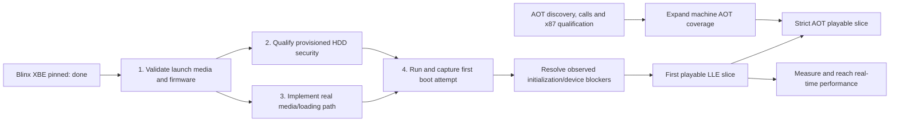

# Blinx: path to the first faithful boot attempt

Updated 2026-10-02. This is a milestone burndown, not a measured calendar
forecast. Packages differ in size; counts are not percent completion.
Central Beads is the issue source of truth.

**Owner pivot, 2026-10-02:** Blinx boot is now the stretch goal behind the
[faithful AOT dashboard](GOAL-AOT-DASHBOARD.md). This ledger preserves its launch
dependencies; it no longer sets the primary work order.

## The next observable milestone

**Attempt to launch Blinx through the real Xbox kernel and capture the first
guest execution or exact blocking failure.** This does not require completion
of the AOT compiler. The existing faithful CPU floor can execute the first
attempt. It does require a valid input/launch route and implemented device
behavior. No stubs, fabricated success or skipped initialization.

The current route has four pending gates. A boot attempt is the next Blinx
milestone, following the primary dashboard work order.
Audio/device work can become necessary to get beyond a boot attempt into menus
or gameplay. Do not postpone the first attempt until all of those projects end.

## Burndown ledger

| Gate | Status | Completion evidence | Tracker |
| --- | --- | --- | --- |
| Pin existing Blinx XBE | Complete | NA retail, title 4D530013, XDK 4831; SHA-256 recorded in private inventory | beads-xbox.1.7.1 |
| 1. Validate launch inputs | In progress | Selected firmware and full game files/media can support a real-kernel launch; missing metadata explicitly recorded | beads-xbox.1.7.1 |
| 2. Qualify drive security | Boot subset implemented; broader qualification open | Security tests pass; provisioned 12B dashboard replay exactly matches the reference frame | beads-xbox.1.28 |
| 3. Implement media/loading | Pending | Real sector reads, required ATAPI status/DMA/IRQs and loader behavior pass tests; no spoofed security success | beads-xbox.1.7.1 |
| 4. First boot attempt | Pending | Reproducible command, input identities, entry-PC/device trace and exact first failure or progress marker | beads-xbox.1.7.1 |
| Reach gameplay | Pending | New game and reproducible movement/combat/time-control route through implemented hardware | beads-xbox.1.7.2 |
| Complete playable slice | Pending | Audio, input, transition and save/reload validated | beads-xbox.1.7.2 |
| Strict AOT slice | In progress: foundations | Compiled game and kernel execute the declared post-boot route with zero CPU JIT/interpreter fallback | beads-xbox.1.25.5 |
| Real-time slice | Pending | Original-speed guest progress, distinct frames, audio and latency on the development PC | beads-xbox.1.7.2 |

Current snapshot: **4 of 4 first-attempt gates remain**. There is not yet a
velocity history from which to draw an honest date-based burndown line. Append
dated gate completions below; do not infer a calendar from checkboxes.

| Date | First-attempt gates remaining | Evidence |
| --- | ---: | --- |
| 2026-10-02, initial inventory | 3 | XBE inspected; runtime DVD remains no-media; no Blinx launch attempted |
| 2026-10-02, drive-contract audit | 4 | Scope increased: pre-existing unconditional HDD unlock and freeze no-op discovered; zero gates closed |
| 2026-10-02, media audit | 4 | Three images hashed and bounded filesystem trees inspected; original Blinx/JSRF XBEs match extracted copies; authentication and launch suitability remain unqualified |
| 2026-10-02, drive implementation | 4 | Provisioned authentication and explicit unlocked mode implemented; 61 tests pass; 12B dashboard replay matches reference; broader drive qualification remains open |

## What changes the estimate

Input suitability is the first uncertainty. The owner supplied a network share
containing full-size Blinx Rev 1 media and smaller Blinx/JSRF images, in addition
to extracted directories. The full-size Blinx image has a valid XDVDFS descriptor
and bounded directory/file extents. Its XBE differs from the previously pinned
extracted XBE: versions must remain separate qualification inputs. A readable
filesystem does not establish optical authentication behavior. Confirm the
real-kernel launch route before assigning implementation dates; missing metadata
is an input blocker, never permission to emulate successful authentication.

All three inspected XBEs declare media mask `0x00000002` (DVD-X2 only). An
unmodified launch must respect that restriction; copying the title to HDD is
not a qualified substitute. The smaller Blinx image matches the original
XDK 4831 compiler input, while Rev 1 uses XDK 5558. JSRF's image matches its
extracted XDK 4134 XBE. The complete local manifest is
`build/aot-20261002/media.aot-private.json`; source images remain unchanged.

The current DVD model explicitly reports no media. The IDE audit found
unconditional HDD password acceptance and a freeze-lock no-op. Both were
replaced with a provisioned authentication model and stateful freeze behavior.
The old stop at 17,940,376 instructions is cleared: a provisioned retail run
completes the 12B dashboard replay without fault and matches its reference image. An explicit unlocked-drive
configuration is the owner's documented narrow exception. See the
[implemented contract and remaining qualification](HDD-SECURITY.md).
This is platform validation, not a Blinx boot attempt. The APU has limited device
behavior and no audio output. These are distinct from AOT compiler coverage.
The first boot trace establishes which missing behaviors actually block Blinx.

Report three dates separately when evidence permits a forecast: first attempt,
first playable LLE, and performant strict AOT. A failed but fully instrumented
first attempt can close gate 4, but cannot close successful kernel launch or
gameplay. Keep the owning issue open until its acceptance criteria pass.

## AOT work already underway

- An XBE inventory records static instructions, unresolved transfers and
  unclassified section bytes without emitting certificate secrets or game code.
- General guest CALL/RET, register/constant PUSH and register POP now have
  authored and differential checks, including interrupted calls and flags.
- An isolated ten-instruction path across two Blinx code regions passes O0/O2
  with matching architectural state and all 64 MiB RAM at every prefix, and zero
  fallback inside its explicitly warmed scope. This is not a kernel/game boot.
- A test-only x87 helper experiment checks existing extended-precision
  arithmetic outside JIT execution; production x87 integration remains open.
- No donor runtime has been transplanted. Rejected paths include control-register
  stubs, unimplemented-op continuation, and forced DSP acknowledgements.

HLE can be scheduled only after its LLE counterpart exists and its full
guest-visible behavioral contract is demonstrated. ABI compatibility alone
does not qualify an HLE replacement.
